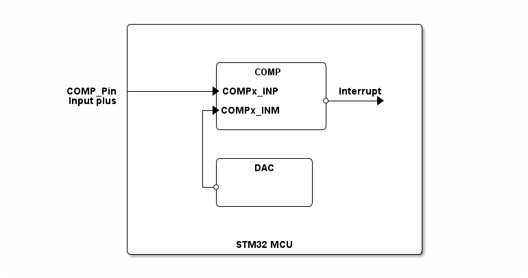

# __Example: *hal_comp_dac_it*__

**Example version:** 2.0.0

[](https://dev.st.com/stm32cube-docs/examples/arch-v1/en/index.html "An offline version is also available in the STM32Cube firmware package.")

Use a comparator peripheral to compare a voltage level applied on a GPIO pin versus configurable voltage generated by DAC peripheral, in interrupt mode and during stop mode.


## __1. Detailed scenario__

__Initialization phase__: At main program start, the `mx_system_init()` function is called. It initializes the peripherals, nonvolatile memory (such as flash memory, NVM, or external memories), MPU regions (if applicable), the system clock, and the SysTick.

The application executes the following __example steps__:

__Step 1__: initialises the COMP instance.

__Step 2__: initialises the DAC instance.

__Step 3__: starts the comparator in interrupt mode.

__Step 4__: the DAC outputs a different voltage at each call. The DAC conversion is done automatically as soon as the value for the output is set.

__Step 5__: switches to STOP mode. When the comparator input crosses (rising or falling edge) the dac output, the comparator generates an interrupt and system wakes-up from Stop mode.

__Step 6__: waits for the wake up from Stop mode (through the EXTI line), then re-configures the clock. Restores the systick.

When the system is in stop mode. The LED is off. Once a rising or falling edge is detected. The system wakes up and the LED blinks once.

__End of example__: This example is repeated endlessly (step 3 to step 5 are executed in loop).


## __2. Example configuration__

[](https://dev.st.com/stm32cube-docs/examples/arch-v1/en/configure/config_toc.html "An offline version is also available in the STM32Cube firmware package.")

This example demonstrates the following peripheral(s):

__COMP__:

The comparator has configurable plus and minus inputs used for flexible voltage selection:

- The minus input of the comparator is connected to dac channel.
- The plus input is connected to various sources, such as an external voltage supply.
- The interrupt generation capability of the comparator allows the system to wake-up from Stop modes through the EXTI controller.

__DAC__:

  - hardware trigger software
  - 8-bits DAC data are used with right alignment.
  - Output buffer is enabled
  - Output connection internal

__PWR__:

When calling the function to enter STOP mode, we need to specify the wake up parameter:

- HAL_PWR_LOWPOWER_MODE_WFI (Wait For Interrupt).

In this example, we use the deepest Stop mode. But, the use case can work with any stop mode valid in the STM32 series.


## __3. Hardware environment and setup__

### __3.1. Generic Setup__

This section describes the hardware setup principles that apply to any board.

<!--
```
@startuml
@startditaa{doc/STMicroelectronics.example_hal_comp_dac_it.png}

                /------------------------------------------\
                |                                          |
                |                                          |
                |                                          |
                |            /---------------\             |
                |            |     COMP      |             |
                |            |               |             |
       COMP_Pin +----------+->COMPx_INP      |Interrupt    |
     Input plus |            |               *--+--+->     |
                |          +->COMPx_INM      |             |
                |          | |               |             |
                |          | \---------------/             |
                |          |                               |
                |          |                               |
                |          | /-------------\               |         
                |          | |     DAC     |               |
                |          | |             |               |
                |          +-*             |               |
                |            |             |               |
                |            \-------------/               |             
                |                                          |
                |                                          |
                |                                          |
                |               STM32 MCU                  |
                \------------------------------------------/


@endditaa
@enduml
```
-->



### __3.2. Specific board setups__

Please find the exact hardware configurations of your project below.


<details>
  <summary>On STM32H7P series.</summary>
  <details>
    <summary>On board NUCLEO-H7P5II.</summary>

  |  MCU pin  |  Signal name  |  User Label   |
  |:---------:|:-------------:|:-------------:|
  |    PG9    |     GPIO      | MX_STATUS_LED |
  |    PA2    |   USART2_TX   | DBGIN_VCP_TX  |

  </details>

  <details>
    <summary>On board NUCLEO-H7P5II.</summary>

  |  MCU pin  |  Signal name  |  User Label   |
  |:---------:|:-------------:|:-------------:|
  |    PG9    |     GPIO      | MX_STATUS_LED |
  |    PA2    |   USART2_TX   | DBGIN_VCP_TX  |

  </details>

  <details>
    <summary>On board STM32H7P5I-DK.</summary>

  |  MCU pin  |  Signal name  |  User Label   |
  |:---------:|:-------------:|:-------------:|
  |    PH6    |     GPIO      | MX_STATUS_LED |
  |    PA2    |   USART2_TX   |  MCU_VCP_TX   |

  </details>
</details>


## __4. Troubleshooting__

[](https://dev.st.com/stm32cube-docs/examples/arch-v1/en/debug/debug_toc.html "An offline version is also available in the Cube Firmware package.")

Here are the points of attention for this specific example:

  1. Using the buffer feature of the DAC can decrease its accuracy. To have further information about the DAC accuracy, you can
  check the datasheet and the reference manual corresponding to your MCU.

  2. To apply an external voltage, there are two propositions that we can have:

      - Connection to a fixed voltage (3.3V):
        - Connect the GPIO pin directly to a 3.3V source on the board (for example, a 3.3V pin from the board's power supply).
        - This can be done using a jumper wire or jumper.
      - Using an external power source:
        - Connect an external power source (for example, a laboratory power supply) to the configured GPIO pin.
        - Make sure the applied voltage is within the acceptable range for the comparator and GPIO pin (e.g. 0V to 3.3V).

  3. When exiting from STOP mode, the system clock must be configured (see the RCC peripheral section in the reference manual of your MCU).

  4. Any peripheral interrupt occurring when the AHB/APB clocks are present (if the peripheral vector is enabled in the NVIC) can wake up the system from STOP mode (not only EXTI). That is the reason why the SysTick interrupt is switched off before entering in STOP mode.

  5. When no external signal is applied on COMP pin, the input is floating and may result in random COMP trigger and system wake up.


## __5. See Also__

[](https://dev.st.com/stm32cube-docs/examples/arch-v1/en/more/more_toc.html "An offline version is also available in the STM32Cube firmware package.")

More information about the STM32 Cube Drivers can be found in the drivers' user manual of the STM32 series you are using.

For instance for the STM32C5 series: [HAL documentation](https://dev.st.com/stm32cube-docs/stm32c5xx-hal-drivers/latest/en/index.html).

More information about the STM32 ecosystem can be found in the [STM32 MCU Developer Zone](https://www.st.com/content/st_com/en/stm32-mcu-developer-zone/embedded-software.html).


## __6. License__

Copyright (c) 2026 STMicroelectronics.

This software is licensed under terms that can be found in the LICENSE file in the root directory
of this software component.
If no LICENSE file comes with this software, it is provided AS-IS.
