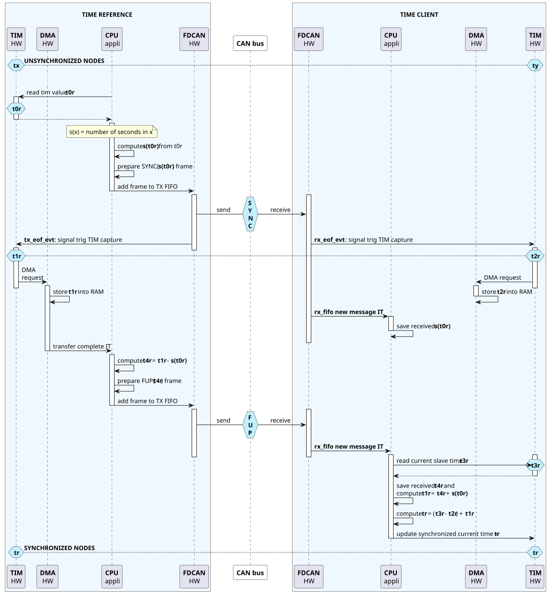
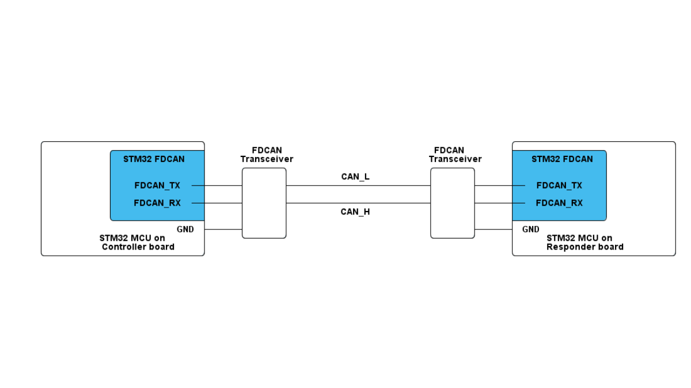

# __Example: *hal_fdcan_two_boards_time_sync_client*__

**Example version:** 2.0.0

[](https://dev.st.com/stm32cube-docs/examples/arch-v1/en/index.html "An offline version is also available in the STM32Cube firmware package.")

How to synchronize the local responder time from a controller board with FDCAN end-of-frame timestamping and HAL APIs.


## __1. Detailed scenario__

__Initialization phase__: At main program start, the `mx_system_init()` function is called. It initializes the peripherals, nonvolatile memory, the system clock, and the SysTick.

The application executes the following __example steps__:

__Step 1__: initializes the FDCAN instance and the generated timer capture path.
              registers the callbacks used during the synchronization cycle.

__Step 2__: starts the receive end-of-frame timestamp capture.

__Step 3__: waits for one synchronization frame followed by its follow-Up frame.
              stores the seconds value from synchronization and the nanoseconds value from follow-Up.
              waits for the synchronization reception end-of-frame timestamp capture.

__Step 4__: stops the timestamp capture window.
              reconstructs controller absolute time from synchronization/follow-Up values.
              updates responder local time and resets synchronization state.

__End of example__: The responder waits for synchronization and follow-Up frames indefinitely if no error occurs.

### __Sequence diagram__

The sequence diagram shows how the controller sends a SYNC frame and then a FOLLOW_UP frame to distribute a precise time reference. On the responder side, the TIM -> DMA -> CPU callback chain processes the Follow Up reception to reconstruct the full timestamp.



If you enable **`USE_TRACE`**, you can follow the synchronization cycles, in the nominal case of execution, in the terminal logs:

```text

[INFO] Client: initialization COMPLETED. Waiting for SYNC/FUP frames.
[INFO] Client: received SYNC (seconds = 12), FUP (nanoseconds = 345678000). Synchronized time = 12345678000 ns.
[INFO] Client: received SYNC (seconds = 13), FUP (nanoseconds = 346789000). Synchronized time = 13346789000 ns.
```


## __2. Example configuration__

[](https://dev.st.com/stm32cube-docs/examples/arch-v1/en/configure/config_toc.html "An offline version is also available in the STM32Cube firmware package.")

This example demonstrates the **FDCAN peripheral** configured as indicated below:

- The FDCAN standard (11 bits) frame format is selected.
- The FDCAN IP is configured to run at 500 kbit/s for nominal phase (sampling point at 75%) and 2 Mbit/s for data phase (sampling point at 80%).
- The FDCAN-bus timings are directly generated by STM32CubeMX2 by referring to the FDCAN initialization section in the reference manual.
- The selected GPIO pins support the FDCAN alternate function. They are configured in push pull mode.
- The frames use FDCAN FD format with bit-rate switching and an 8-byte payload.
- The generated timer runs with a 125 ns time base.
- One timer capture channel is connected internally to `FDCAN1_RX` to timestamp the SYNC reception end of frame.
- The FDCAN filter is configured to store SYNC_FRAME_ID frame in RX_FIFO_0 and reject all other standard frames.
- The FDCAN Tx mode is configured in FIFO mode.
  It can optionally be configured in Queue mode: Messages stored in the Tx queue will be transmitted starting with the message with the lowest message ID (highest priority) instead of First In First Out.


## __3. Hardware environment and setup__

### __3.1. Generic Setup__

The FDCAN bus uses CAN_H and CAN_L lines and requires a CAN or FDCAN transceiver.

No extra external wire is required between FDCAN and TIM because the end-of-frame event is routed internally inside the MCU.



### __3.2. Specific board setups__

The example is developed only for `NUCLEO-C542RC` and `NUCLEO-C562RE`.
`NUCLEO-C5A3ZG` is not supported because it has no onboard FDCAN transceiver.

<details>
  <summary>On STM32H7P series.</summary>
  <details>
    <summary>On board NUCLEO-H7P5II.</summary>

  |  MCU pin  |  Signal name  |  User Label   |
  |:---------:|:-------------:|:-------------:|
  |    PG9    |     GPIO      | MX_STATUS_LED |
  |    PH0    |  RCC_OSC_IN   |       -       |
  |    PH1    |  RCC_OSC_OUT  |       -       |
  |    PA2    |   USART2_TX   |       -       |
  |   PB13    |   FDCAN1_TX   |       -       |
  |   PB12    |   FDCAN1_RX   |       -       |

  </details>
</details>


## __4. Troubleshooting__

[](https://dev.st.com/stm32cube-docs/examples/arch-v1/en/debug/debug_toc.html "An offline version is also available in the STM32Cube firmware package.")

Here are the points of attention for this specific example:

- Start this responder example before starting the controller example.
- Keep the same nominal and data bit timings on both boards.
- The responder filter must accept the standard identifier `0x111` before the FDCAN peripheral is started.


## __5. See Also__

[](https://dev.st.com/stm32cube-docs/examples/arch-v1/en/more/more_toc.html "An offline version is also available in the STM32Cube firmware package.")

This [application note](https://www.st.com/resource/en/application_note/an5348-introduction-to-fdcan-peripherals-for-stm32-mcus-stmicroelectronics.pdf)
explains in detail the FDCAN IP features and their applications.

The documentation of the drivers of the relevant STM32 series contains more detailed information.

For STM32C5 series, see the [HAL documentation](https://dev.st.com/stm32cube-docs/stm32c5xx-hal-drivers/latest/en/index.html).

More information about the STM32 ecosystem can be found in the [STM32 MCU Developer Zone](https://www.st.com/content/st_com/en/stm32-mcu-developer-zone/embedded-software.html).


## __6. License__

Copyright (c) 2026 STMicroelectronics.

This software is licensed under terms that can be found in the LICENSE file in the root directory
of this software component.
If no LICENSE file comes with this software, it is provided AS-IS.
