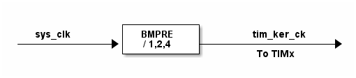

# __Example: *hal_fmac_iir_it_to_dac_dma*__

**Example version:** 2.0.0

[](https://dev.st.com/stm32cube-docs/examples/arch-v1/en/index.html "An offline version is also available in the Cube Firmware package.")

How to use the FMAC peripheral to filter a noisy signal using interrupt mode for FMAC input data loading, direct DMA transfer from the FMAC output register to the DAC, and a timer trigger to pace DAC conversions.

The input signal is generated by software and stored in the application as 512 floating-point samples between -1 and 1. It is not captured from a microphone or an external ADC. TIM6 paces the DAC conversions at about 60 kHz, so the sample array represents a periodic test waveform with a useful low-frequency component around 1.3 kHz and a high-frequency noise component around 26 kHz. The samples are converted to Q1.15 format before being written to the FMAC X1 input buffer.

The IIR filter is used to attenuate the high-frequency component while preserving the lower-frequency part of the waveform. The filtered Q1.15 samples are then streamed directly from the FMAC Y output register to the DAC.

The provided IIR coefficients are intended for demonstration purposes only. They are not necessarily optimal for every application and should be recalculated according to the required filtering characteristics, including sampling frequency, cutoff frequency, transition band, and attenuation requirements.


## __1. Detailed scenario__

__Initialization phase__: At main program start, the `mx_system_init()` function is called. It initializes the peripherals, nonvolatile memory (such as flash memory, NVM, or external memories), MPU regions (if applicable), the system clock, and the SysTick.

The application executes the following __example steps__:

- __Step 1__: Configures the FMAC peripheral, DAC and timer, then registers the FMAC and DAC user callbacks.

- __Step 2__: Preloads X2 with the filter coefficients, converts the input samples to Q1.15 format, and writes the X1 input buffer in interrupt mode.

- __Step 3__: Gets the FMAC Y output register address and locks Y read access for the DAC DMA transfer.

- __Step 4__: Starts DAC DMA from the FMAC Y output register address, then starts the timer to pace DAC conversions.

- __Step 5__: Starts the FMAC IIR filter.

- __Step 6__: Deinitializes the FMAC, DAC and timer peripherals.

__End of example__: Reports the outcome of the data transfer via the variable **`ExecStatus`** and the **status LED** remains turned on in case of success.

If you enable `USE_TRACE`, you can follow these execution steps in the terminal logs:

```text
[INFO] Step 1: FMAC, DAC and timer initialization COMPLETED.
[INFO] Step 2: FMAC inputs configured.
[INFO] Step 3: FMAC Y output address retrieved and Y read access is locked for DAC DMA.
[INFO] Step 4: DAC DMA started from FMAC output while TIM trigger paces conversions.
[INFO] Step 5: FMAC IIR filter started.
[INFO] Step 6: Peripherals de-initialized: FMAC, DAC and timer.
```


## __2. Example configuration__

[](https://dev.st.com/stm32cube-docs/examples/arch-v1/en/configure/config_toc.html "An offline version is also available in the Cube Firmware package.")

__FMAC__: is configured with the following parameters:

- The FMAC coefficient vector size is 13: 7 feed-forward B coefficients followed by 6 feedback A coefficients.
- The IIR coefficients are defined in Q1.15 format and preloaded into the FMAC X2 buffer in the order required by the FMAC: B coefficients first, then A coefficients.
- The FMAC addresses and sizes used for X1, X2 and Y buffer are configured to not overlap:
  - 0 to 12: coefficient buffer;
  - 13 to 133: input buffer;
  - 134 to 254: output buffer;

__DMA__: is configured with the following parameters:

- The DMA channel is used by the DAC to transfer filtered samples directly from the FMAC Y output register address to the DAC data register.
- The DMA transfer is configured in Memory-to-Peripheral mode with a fixed source address and a fixed destination address.
- The source address points to `FMAC->RDATA`, obtained through `HAL_FMAC_GetYAddress()`.
- The DMA source data width is configured to halfword to match the FMAC Q1.15 output data width.
- The corresponding DMA interrupt and NVIC line are configured and enabled.

__DAC__: is configured with the following parameters:

- The DAC channel is triggered by timer.
- The DAC data alignment is configured to 12-bit right alignment.
- The DAC data sign format is configured as signed to consume the Q1.15 samples read directly from the FMAC output.

__TIM__: Configured to trigger the DAC with the following parameters:

- Timer update event is used as an output trigger (TRGO) and selected as the DAC trigger.
- Timer parameters are configured to generate DAC trigger events at about 60 kHz.
- The repetition counter (if present) is not used here.


<details>
  <summary>The aim is to pace DAC conversions at about 60 kHz.</summary>
  TIM6 generates the trigger events used by DAC1 to request DMA transfers from the FMAC Y output register.
  Therefore, the timer update frequency defines the DAC conversion rate:
    > TRGO_freq ~= 60 kHz

  *Note:* This frequency corresponds to the timer frequency.

  To get this frequency, the period should be configured according to the formula below:
    > TRGO_freq = Timer_clock_freq/((PRESCALER_VALUE + 1) * (PERIOD_VALUE + 1))

  *Note:* The "+1" used in formulas is needed because the registers values start from 0.

  Ideally the solution to the above equation should be found with a low PRESCALER_VALUE to have a better precision.
  The PERIOD_VALUE must not overflow the ARR register (16bits/32bits).

  > PERIOD_VALUE = (Timer_clock_freq/(TRGO_freq * (PRESCALER_VALUE + 1))) - 1
</details>


## __3. Hardware environment and setup__

### __3.1. Generic Setup__

The hardware setup of the timer counter applies to any board with the same clock tree.

<details>
  <summary>On board with STM32v8xx MCUs</summary>

  <summary>Common configuration</summary>

  Timer's counter clock configuration:

  - The timer's internal input clock (tim_ker_ck) also named bus clock (bus_ck) depends on the system clock (sys_clk) according to this formula:
      bus_clk = sys_clk / BMPRE
      With BMPRE the Bus Matrix clock prescaler

      So, tim_ker_ck = sys_clk / BMPRE in Hz

  To obtain the timer's counter clock frequency (tim_cnt_ck), the timer prescaler register (TIM_PSC) is computed as follows:

      TIM_PSC = ( (sys_clk / BMPRE) / tim_cnt_ck ) - 1
<!---
@startuml
@startditaa{doc/stm32v8_peripherals_clocks.png}

               +----------+
  sys_clk      |  BMPRE   |      tim_ker_ck
------------+->+ / 1,2,4  +-----------------+->
               +----------+       To TIMx


@endditaa
@enduml
-->
  

In this configuration:

- The sys_clk is set to 800 MHz.
- The BMPRE prescaler is set to 2 so the tim_ker_ck = 400 MHz.

  PERIOD_VALUE calculation with APB prescaler set to 1 and HCLK set to 144 MHz:
  > PERIOD_VALUE = (Timer_clock_freq/(TRGO_freq * (PRESCALER_VALUE + 1))) - 1

  This equation can be resolved with:
  > PRESCALER_VALUE = 0
  >
  > PERIOD_VALUE = (400 MHz / 60 kHz) - 1
  > PERIOD_VALUE = 6667

  </details>

### __3.2. Specific board setups__

This section describes the exact hardware configurations of your project.

<details>
  <summary>On STM32H7P series.</summary>
  <details>
    <summary>On board NUCLEO-H7P5II.</summary>

  |  MCU pin  |  Signal name  |  User Label   |
  |:---------:|:-------------:|:-------------:|
  |    PG9    |     GPIO      | MX_STATUS_LED |
  |    PA2    |   USART2_TX   |       -       |
  |    PA4    |   DAC1_OUT1   |       -       |

  </details>

  <details>
    <summary>On board STM32H7P5I-DK.</summary>

  |  MCU pin  |  Signal name  |  User Label   |
  |:---------:|:-------------:|:-------------:|
  |    PH6    |     GPIO      | MX_STATUS_LED |
  |    PA2    |   USART2_TX   |       -       |
  |    PA4    |   DAC1_OUT1   |       -       |

  </details>
</details>


## __4. Troubleshooting__

[](https://dev.st.com/stm32cube-docs/examples/arch-v1/en/debug/debug_toc.html "An offline version is also available in the Cube Firmware package.")

Here are the points of attention for this specific example:

- Ensure the DMA source address is the FMAC Y output register address returned by `HAL_FMAC_GetYAddress()`.
- The DAC DMA source address must remain fixed because each DMA request reads the same FMAC output register.
- The DAC data sign format must match the raw Q1.15 FMAC output data.
- The timer trigger frequency defines the DAC output rate and must not exceed the FMAC output production rate.


## __5. See Also__

[](https://dev.st.com/stm32cube-docs/examples/arch-v1/en/more/more_toc.html "An offline version is also available in the Cube Firmware package.")

- [Application Note AN5305](https://www.st.com/resource/en/application_note/an5305-digital-filter-implementation-with-the-fmac-using-stm32cubeg4-mcu-package-stmicroelectronics.pdf): Digital filter implementation with the FMAC using STM32CubeG4 MCU Package

More information about the STM32 Cube Drivers can be found in the drivers' user manual of the STM32 series you are using.

For instance for the STM32C5 series: [HAL documentation](https://dev.st.com/stm32cube-docs/stm32c5xx-hal-drivers/latest/en/index.html).

More information about the STM32 ecosystem can be found in the [STM32 MCU Developer Zone](https://www.st.com/content/st_com/en/stm32-mcu-developer-zone/embedded-software.html).


## __6. License__

Copyright (c) 2026 STMicroelectronics.

This software is licensed under terms that can be found in the LICENSE file in the root directory
of this software component.
If no LICENSE file comes with this software, it is provided AS-IS.
