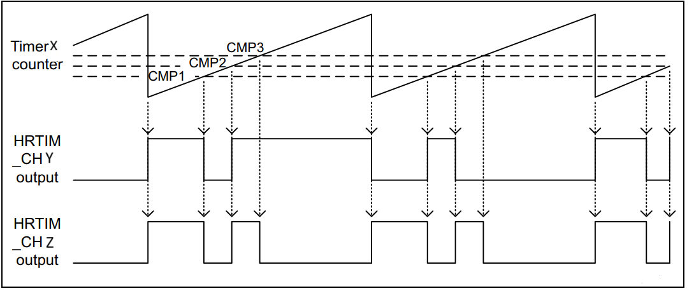

# __Example: *hal_hrtim_basic_arbitrary_waveform*__

**Example version:** 2.0.0

How to configure the HRTIM peripheral in continuous mode to generate two basic non-PWM waveforms with multiple set/reset/toggle requests.
The waveforms generated by the HRTIM output channels can be displayed using an oscilloscope.

## __1. Detailed scenario__

This scenario demonstrates how to configure a HRTIM to generate two basic non-PWM waveforms.

__Initialization phase__: At main program start, the `mx_system_init()` function is called. It initializes the peripherals, nonvolatile memory (such as flash memory, NVM, or external memories), MPU regions (if applicable), the system clock, and the SysTick.

The application executes the following __example steps__:

__Step 1__: Initializes the input clock, counter clock, and output clock of the HRTIM timer. Configures the output channels and the GPIO pins. Starts the periodic DLL calibration.

__Step 2__: Starts the timer non-PWM waveform generation on each HRTIM output.

__End of example__: If no error occurs, both waveforms are generated indefinitely.

## __2. Example configuration__

### __2.1. Timer configuration__

The *HRTIM* is configured as follows:

- When available, the delay-locked loop (DLL) must be calibrated before high resolution can be used.
- The HRTIM timer is configured in continuous (free-running) and up counting modes.
- The HRTIM timer prescaler aand period are configured to generate signals at 100 kHz.
- For the HRTIM output channels, the output active level is HIGH. The set/reset sources of the crossbar are configured in a way to generate two different non-PWM waveforms:

  - First channel: toggle on TIMx period (TIMx_PERIOD), toggle on TIMx compare unit1 (TIMx_CMP1), toggle on TIMx compare unit2 (TIMx_CMP2).
  - Second channel: set on TIMx_PERIOD and TIMx_CMP2, reset on TIMx_CMP1 and TIMx_CMP3.
  - TIMx_CMP1 = TIMx_PERIOD / 4;
  - TIMx_CMP2 = 3 * TIMx_PERIOD / 8;
  - TIMx_CMP3 = TIMx_PERIOD / 2;

Arbitrary waveform generation for both channels is illustrated by this figure: 

Note that the HRTIM timer configuration depends on the HRTIM peripheral input clock, which is derived from the system clock tree.
So, it is required to define the system clock configuration and to determine the HRTIM timer input clock before defining the HRTIM timer and output channel configuration.

The system clock configuration is specific to each STM32 MCU (see section [Hardware environment and setup](#3-hardware-environment-and-setup)).

### __2.2. GPIO configuration__

Two pins must be configured for each waveform signal: [see the specific boards setups](#32-specific-board-setups)

Each GPIO pin is configured in:

- Alternate function as a HRTIM output channel of its respective timer instance.
- Push-pull mode with no pull-up or pull-down resistors activated.

## __3. Hardware environment and setup__

### __3.1. Generic Setup__

Each signal generated by the timer channel can be displayed by connecting an oscilloscope to the corresponding board connector.

### __3.2. Specific board setups__

  
On STM32H7P series.

  

    
Common configuration.

  To provide the high resolution, the HRTIM must be fed directly by the PLL high-frequency output.

  Each timer in the HRTIM has its own individual clock prescaler, which is used to adjust the timer high-resolution clock fHRCK.

  Standard STM32H7Pxx HRTIM clock distribution diagram:
<!--
@startuml
@startditaa{doc/stm32h7p_hrtim_peripheral_clock.png}

      ++-\                  +--\                       +-------------+
      +  |                  |  |                       |             |
PLL1P |  |       sys_clk    |  |               fHRTIM  |  Prescaler  |      fHRCK
---+--+  +------------------+  +----------+------------+             +-------------------
      |  |                  |  |                       +-------------+
 HSE  |  |                  |  |
---+--+  |        bus ---+--+  |
      |  |                  |  |
MCGSYS|  |                  +--/
---+--+  |
      |  |
      +--/

/--------------------------------------------------------------------------------------\
| sys_clk     system clock                                                             |
| fHRTIM      main HRTIM clock (hrtim_ker_ck)                                          |
| prescaler   individual clock prescaler per timer used to adjust the timer resolution |
| fHRCK       timer high-resolution equivalent clock                                   |
\--------------------------------------------------------------------------------------+

@endditaa
@enduml
-->

  

In this configuration:

- The sys_clk is set to 520 MHz.
- The HRTIM kernel clock is fed directly by sys_clk.
- fHRTIM: set to 520 MHz.
- fHRCK: set to 520 MHz (prescaler = 1).

With a 520 MHz input clock, the period is set to 100 kHz as indicated below:
PER = fHRCK / fPWM = 520MHz / 100 kHz = 5200

- TIMx_CMP1 = TIMx_PERIOD / 4 = 1300;
- TIMx_CMP2 = 3 * TIMx_PERIOD / 8 = 1950;
- TIMx_CMP3 = TIMx_PERIOD / 2 = 2600;

Two arbitrary waveforms are generated on HRTIMx_CHx1 and HRTIMx_CHx2 outputs, with the following conditions:

- HRTIMx_CHx1: toggle on TIMx period, toggle on TIMx compare unit1, toggle on TIMx compare unit2.
- HRTIMx_CHx2: set on TIMx_PERIOD and TIMx_CMP2, reset on TIMx_CMP1 and TIMx_CMP3.

  

  

    
On board NUCLEO-H7P5II.

  The selected timer is TIMB with TIMB_CHB1 and TIMB_CHB2 selected as outputs.
  HRTIM1_CHB1 selected as CHx1.
  HRTIM1_CHB2 selected as CHx2.

  | Board connector  and pin  | CPU pin | Signal name    | ARDUINO  connector pin |
  | :---:                        | :---:   | :---:          | :---:                     |
  | CN5_3                        | PB7     | HRTIM1_CHB1    |   ARDUINO CONNECTOR - D10 |
  | CN9_6                        | PA10    | HRTIM1_CHB2    |   ARDUINO CONNECTOR - D5  |

  

## __4. Troubleshooting__

Here are the points of attention for this specific example:

__System clock__:

- To provide the high resolution, the HRTIM must be fed directly by the PLL high-frequency output.
- The HRTIM clock depends on the system clock configuration. Changing the CPU clock or the peripheral bus' clock affects the generated signal frequency.

__GPIO slew rate__:

The GPIO slew rate is an important parameter that affects the performance of high-frequency signals. Refer to the AN4899 application note in case of issues.

## __5. See Also__

This [HRTIM cookbook (ref. AN4539)](https://www.st.com/content/ccc/resource/technical/document/application_note/13/d6/48/9d/11/11/4c/08/DM00121475.pdf/files/DM00121475.pdf/jcr:content/translations/en.DM00121475.pdf) presents an overview of the HRTIM peripheral for the STM32 product series and and a collection of examples.

More information about the STM32 ecosystem can be found in the [STM32 MCU Developer Zone](https://www.st.com/content/st_com/en/stm32-mcu-developer-zone/embedded-software.html).

## __6. License__

Copyright (c) 2026 STMicroelectronics.

This software is licensed under terms that can be found in the LICENSE file in the root directory
of this software component.
If no LICENSE file comes with this software, it is provided AS-IS.
