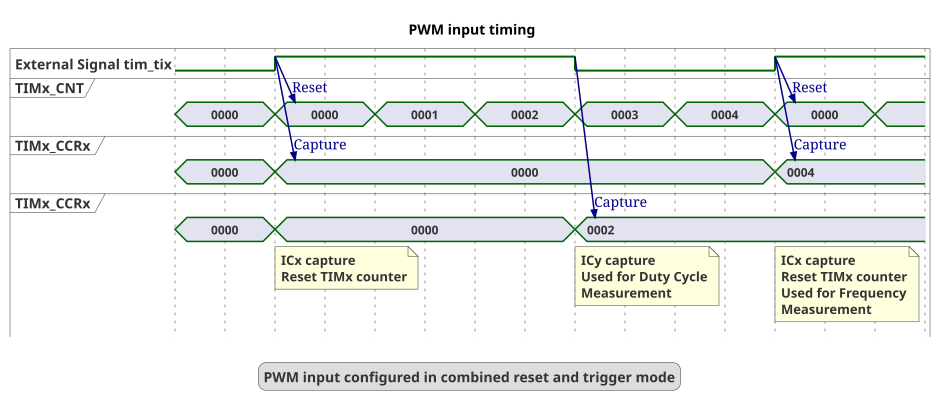
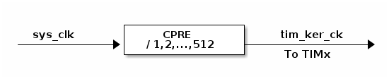

# __Example: *hal_tim_pwm_input*__

**Example version:** 2.0.6

How to configure the TIM peripheral in PWM input mode to measure the frequency and duty cycle of an external signal.

## __1. Detailed scenario__

The external signal is received on a timer's input pin, and is routed to two capture/compare registers:

- CCRx measures the period of the signal,
- CCRy measures the duty cycle of the signal.

__Initialization phase__: At main program start, the `mx_system_init()` function is called. It initializes the peripherals, nonvolatile memory (such as flash memory, NVM, or external memories), MPU regions (if applicable), the system clock, and the SysTick.

__Step 1__: Initializes the GPIO and the TIM for PWM input measurement.

  - The timer's internal input clock (tim_ker_ck) is initialized.
  - The timer's counter clock is then configured by setting the appropriate prescaler value.
  - The timer mode is set to "combined reset + trigger mode".
  - The GPIO pin is associated with the timer through an alternate function.
  - Two timer channels are set up to use the same GPIO pin. One channel is responsible for detecting rising edges, while the other channel handles falling edge detection.

__Step 2__: Starts the timer in input capture mode for the two channels.

__Step 3__: The input capture interrupt computes the frequency and the duty cycle on each rising edge of the external input signal.

__Step 4__:  Logs the value of the frequency and the duty cycle of the external PWM signal (if `USE_TRACE` is enabled).
  The displayed value is always the latest measured value.
  Returns to step 3 indefinitely if no error occurs.

__End of example__: As long as no error occurs, the steps 3 to 4 run in an infinite loop.

## __2. Example configuration__

### __2.1. Timer configuration:__

This example demonstrates the following peripherals:

__TIM__:
The timer is configured in PWM input mode with two coupled channels, both mapped to the same GPIO for input capture. The edge detector generates two signals (tim_tixfp1 and tim_tixfp2), which are routed to these channels.
The channels depend on the MCU in use:

  - Either channel 1 coupled with channel 2,

  - Or channel 3 coupled with channel 4.

On rising edge detection, the selected trigger input (tim_trgi) reinitializes the counter, generates an update event, and restarts the counting. This behavior is the "combined reset + trigger mode".

The first capture compare register (CCRx) triggered polarity is set to rising edge. It captures the timing since the last rising edge to measure the period duration.

The second capture compare register (CCRy) triggered polarity is set to falling edge. It captures the timing since the last rising edge to measure the HIGH state duration.

The period value is set to 0xFFFF as it is the maximal value possible for a timer with a 16bits counter.

In this example, the timer's internal input clock (tim_ker_ck) equals the system core clock:

> tim_ker_ck = SystemCoreClock

This is achieved by setting:

- The timer's input clock to its respective APB clock (PCLK)
- The AHB prescaler to 1
- The APB prescaler (depending on series) to 1

To measure a low-frequency PWM signal without timer overflow, the timer counter clock must be low enough so that one full signal period fits within the timer counter range.

For a signal frequency f_pwm and a timer with a maximum counter value TIM_CNT_max, the following condition must be satisfied:

      tim_cnt_ck <= f_pwm x (TIM_CNT_max + 1)

For a 16-bit timer measuring a 50 Hz PWM signal:

      tim_cnt_ck <= 50 x (0xFFFF + 1)
      tim_cnt_ck <= 50 x 65536
      tim_cnt_ck <= 3.2768 MHz

The timer prescaler must therefore be selected so that the timer counter clock does not exceed 3.2768 MHz.

__GPIO__:

We configure the GPIO pin as a timer channel pin, thanks to the appropriate alternate function.

### __2.2. Input PWM frequency configuration:__

__Measurement principle__:

The purpose of the PWM input configuration is to analyze an incoming PWM signal frequency and duty cycle.

PWM analysis mode

  The timer's input channel receives the external signal through the associated GPIO.

  On a rising edge detection, the timer counter value (TIM_CNT) is saved into the first capture compare register (CCRx), then it is reset.

  On a falling edge detection, the timer counter value (TIM_CNT) is saved into the second capture compare register (CCRy), and it is not reset.

  The measurements are made in number of the timer's counter clock cycles:

  - CCRx stores the time between two rising edges, giving the period of the signal.
  - CCRy stores the duration for which the signal remains in the HIGH state.

  This gives the following mathematical relations:

    Signal's period in seconds = period of the timer's counter in seconds * CCRx
    Signal's frequency in Hz = 1 / (period of the timer's counter in seconds * CCRx)

  And the frequency of the timer's counter in Hz is the timer's counter clock. So, this gives:

    Signal's frequency in Hz = timer's counter clock in Hz / CCRx

  Duty cycle is the ratio between the duration for which the signal is in HIGH state (CCRy) to the period of the signal (CCRx). This gives this mathematical formula:

    Signal's duty cycle in % = (CCRy * 100) / CCRx

  

 __Measurement precision__:

The timer clock is limiting the measurable input frequency and measurement accuracy.

PWM precision

  The measured frequency and duty cycle precision depend on the timer settings.
  The timer counts in number of counter's clock cycles (values stored in CCRx and CCRy).
  The clock and the signal edge might not be perfectly aligned, leading to a potential counting error of +/- 1.

  The measurement precision is the ratio of the timer's counter clock frequency (tim_cnt_ck) to the frequency of the PWM signal (F_m).

    precision = tim_cnt_ck / F_m

  The precision cannot exceed the resolution provided by the timer's clock frequency.
  For a measured frequency of F_m Hz, the precision in % is 100 / CCRx.

  For example, for an external PWM signal with a frequency of 40 MHz and the tim_cnt_ck set to 80 MHz:

  - The period of the PWM signal is 25 ns.
  - The period of the tim_cnt_ck is 12.5 ns.

  The period of the PWM signal represents two timer's counter clock cycles (CCRx=2).
  This gives a precision of 50%.

  To achieve a precision p, the value of CCRx must be greater than 100 / p.

  For instance, to reach a duty cycle precision of 5%, the measured PWM period should contain at least 20 timer counts.

  This means that the timer counter clock frequency should be at least 20 times higher than the frequency of the external signal being measured. However, for low-frequency signals, the counter clock must also be low enough to prevent timer overflow when using a 16-bit timer.

  > **_CONCLUSION_**: By ensuring that the timer's clock frequency is much higher than the frequency of the PWM signal, you can minimize the impact of the +/- 1 count uncertainty.

Minimal measurable signal frequency

  When the clock frequency of the external signal is slow enough, the TIM counter can overflow and
  this example does not handle overflow.

  The time to reach the overflow is:

    Overflow period in seconds = (Max TIM_CNT value) / (tim_cnt_ck in Hz)
    Minimum measurable frequency = (tim_cnt_ck in Hz) / (Max TIM_CNT value)

   Maximum TIM_CNT value:

   - 32-bit timer: 0xFFFFFFFF

   - 16-bit timer: 0xFFFF
  Example calculation:

    For a 32-bit timer with tim_cnt_ck = 1 MHz:
    Minimum Measurable Frequency in Hz = 1000000 Hz / 0xFFFFFFFF
    This is approximately 0.00023 Hz
    For a 16-bit timer with tim_cnt_ck = 1 MHz:
    Minimum Measurable Frequency in Hz = 1000000 Hz / 0xFFFF
    This is approximately 15 Hz

## __3. Hardware environment and setup__

### __3.1. Generic Setup__

The timer configuration depends on the timer's input clock.
This clock is derived from the system clock tree.
So, the system clock configuration is a critical setup step.

### __3.2. Specific board setups__

  
On STM32H7P series.

  

    
Common configuration.

  Timer's counter clock configuration:

  - The timer's internal input clock (tim_ker_ck) depends on the system clock (sys_clk) according to this formula:
      tim_ker_ck = sys_clk / CPRE
      With CPRE the CPU domain core prescaler.

      So, tim_ker_ck = sys_clk / CPRE in Hz

  To obtain the timer's counter clock frequency (tim_cnt_ck), the timer prescaler register (TIM_PSC) is computed as follows:

      TIM_PSC = ( (sys_clk / CPRE) / tim_cnt_ck ) - 1

  Standard STM32H7Pxx timer clock distribution diagram:
<!--
@startuml
@startditaa{doc/stm32h7p_peripherals_clocks.png}

               +----------------+
  sys_clk      |     CPRE       |    tim_ker_ck
------------+->+ / 1,2,...,512  +---------------+->
               +----------------+     To TIMx

@endditaa
@enduml
-->
  

In this configuration:

- The sys_clk is set to 520 MHz.
- The CPRE prescaler is set to 1 so the tim_ker_ck = 520 MHz.

To measure a 50 Hz PWM signal with a 16-bit timer, the timer counter clock must be low enough so that one full 20 ms period fits within the timer range.

With tim_ker_ck = 520 MHz:

      TIM_PSC >= (520 MHz / 3.2768 MHz) - 1
      TIM_PSC >= 157.69

A prescaler value of 159 is therefore selected, giving:

      tim_cnt_ck = 520 MHz / (159 + 1) = 3.25 MHz

This prescaler value is selected as a compromise:

- it allows measuring a 50 Hz PWM signal within the 16-bit timer range
- while still keeping acceptable resolution for higher-frequency PWM input capture measurements

  

  

    
On board NUCLEO-H7P5II.

  | Board connector   and pin   | MCU pin | Signal name | ARDUINO   connector pin |
  | :---:                          | :---:   | :---:       | :---:                      |
  | CN9-8                          | PC6     | TIM8_CH1    | ARDUINO CONNECTOR - D9     |

  

## __4. Troubleshooting__

Here are the points of attention for this specific example:

__System clock__: The timer clock depends on the system clock configuration. Changing the CPU clock or the peripheral bus' clock affects the PWM frequency and duty cycle.

__Timer counter clock__:Make sure the timer prescaler is properly selected for the expected PWM frequency range. A lower prescaler increases the timer counter clock and improves measurement precision by providing more counter increments per PWM period, but it can also cause timer overflow for low-frequency signals.

## __5. See Also__

You can also refer to this other example:

- hal_tim_pwm_output.

This [General-purpose timer cookbook for STM32 microcontrollers (ref. AN4776)](https://www.st.com/content/ccc/resource/technical/document/application_note/group0/91/01/84/3f/7c/67/41/3f/DM00236305/files/DM00236305.pdf/jcr:content/translations/en.DM00236305.pdf) provides a simple and clear description of the basic features and operating modes of the STM32 general-purpose timer peripherals.

This [STM32 cross-series timer overview (ref. AN4013)](https://www.st.com/content/ccc/resource/technical/document/application_note/54/0f/67/eb/47/34/45/40/DM00042534.pdf/files/DM00042534.pdf/jcr:content/translations/en.DM00042534.pdf) presents an overview of the timer peripherals for the STM32 product series.

More information about the STM32Cube Drivers can be found in the drivers' user manual of the STM32 series you are using.

For instance for the STM32C5 series: [HAL documentation](https://dev.st.com/stm32cube-docs/stm32c5xx-hal-drivers/latest/en/index.html).

More information about the STM32 ecosystem can be found in the [STM32 MCU Developer Zone](https://www.st.com/content/st_com/en/stm32-mcu-developer-zone/embedded-software.html).

## __6. License__

Copyright (c) 2026 STMicroelectronics.

This software is licensed under terms that can be found in the LICENSE file in the root directory
of this software component.
If no LICENSE file comes with this software, it is provided AS-IS.
