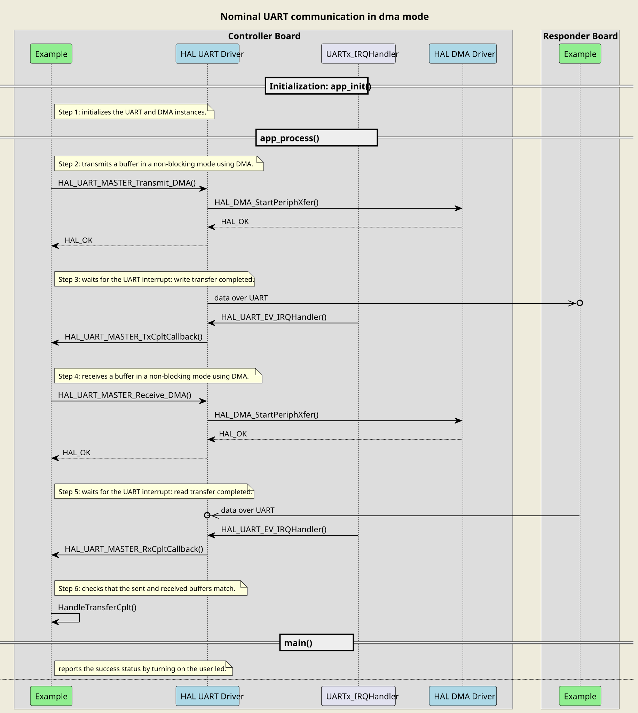
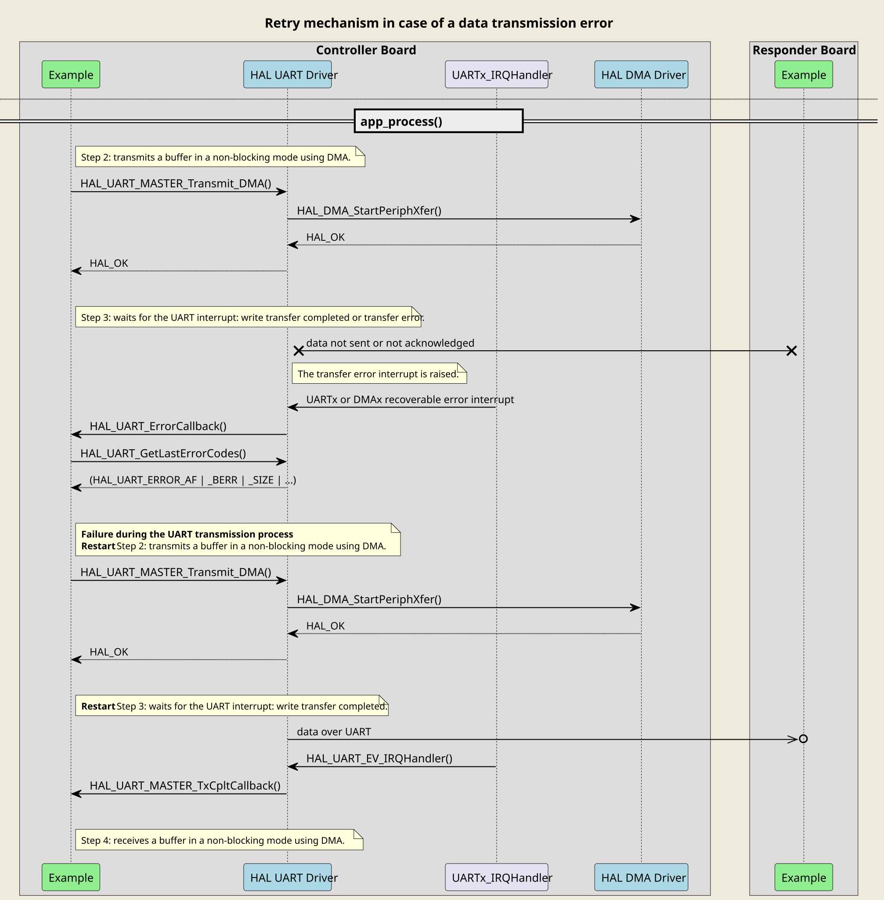
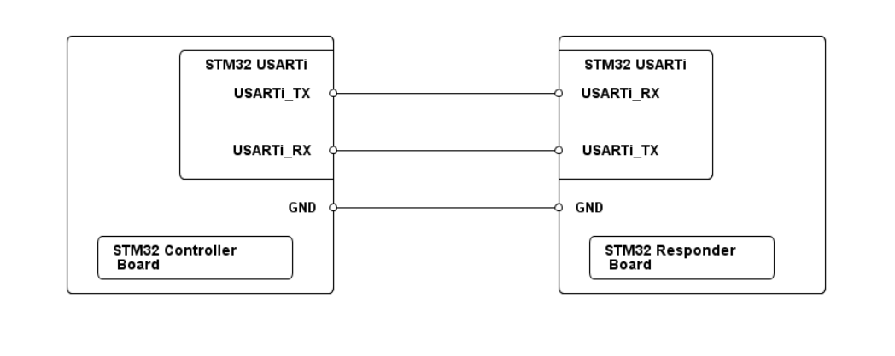

# __Example: *hal_uart_two_boards_com_dma_controller*__

**Example version:** 2.0.0

How to handle an infinite number of transmit-receive transactions between two boards based on the UART-bus protocol with the HAL API, in DMA mode.

The example implements the controller's code.

## __1. Detailed scenario__

__Initialization phase__: At main program start, the `mx_system_init()` function is called. It initializes the peripherals, nonvolatile memory (such as flash memory, NVM, or external memories), MPU regions (if applicable), the system clock, and the SysTick.

The application executes the following __example steps__:

__Step 1__: configures and initializes the UART instance, the NVIC, and the DMA channels.
            Links the transmit and receive DMA handles to the UART handle.
            Registers the user callbacks for UART interrupts: TX/RX transfer completed and transfer error.

__Step 2__: The controller starts the communication, in DMA mode, by sending a message to the responder. A counter of attempts is reset when initiating the communication loop.

__Step 3__: waits for one of these UART interrupts: write transfer complete or transfer error.

__Step 4__: The controller expects to receive the message back in DMA mode.

__Step 5__: waits for one of these UART interrupts: read transfer complete or transfer error.

__Step 6__: The controller checks that the sent and received buffers match.
            Returns to step 2 indefinitely if no error occurs.

If the data transmit or receive operation fails or the exchanged buffers are different, the controller restarts the communication by sending again the same message. The `error_handler()` function is called when the maximum number of attempts is reached.

The communication status is reported via the status LED and the variable ExecStatus.

__End of example__: If no error occurs, the data is transferred infinitely between the controller and the responder. If the maximum number of attempts is reached, the data transfer is stopped and an error status is reported to the main function.

The following **message sequence chart** is used to describe the UART communication behavior between the controller board and the responder board.

 Expand this tab to visualize the sequence chart diagram in case of a data transmission error. 

## __2. Example configuration__

The example demonstrates the following peripheral:

__UART__:

We select a UART with accessible Tx and Rx signals on the board so that we can wire it to the responder board.

The UART is configured with the following settings:

- The baud rate is set to 115200.
- The word length is set to 8 bits.
- Stop bits are set to 1 bit.
- Parity is set to NONE.

<!--
@startuml
@startditaa{doc/ASCII_data_frame.png} -E -S

    The UART data frame of the current configuration:

      /--------------------------------------\
      |  /------+-----------------+-------\  |
      |  |  SB  |   8 bits data   |  STB  |  |
      |  \------+-----------------+-------/  |
      \--------------------------------------/

      /---------------\
      | SB:  Start Bit|
      | STB: Stop Bit |
      \=--------------/
@endditaa
@enduml
-->

__DMA__:

The DMA peripheral is used to manage data transfers.

Two DMA channels UART Tx and UART Rx are configured as indicated below.

The DMA transmit channel is configured in memory to peripheral mode with an incremented source address and a fixed destination address. After each byte transfer, the source address increments automatically to copy the next byte from SRAM to the UART transmit data register.

The DMA receive channel is configured in peripheral to memory mode with a fixed source address and an incremented destination address. The data is loaded from the UART receive data register to an SRAM area incrementally.

For each DMA channel (UART Tx and Rx), the corresponding NVIC line is configured and enabled.

## __3. Hardware environment and setup__

### __3.1. Generic Setup__

This section describes the hardware setup principles that apply to any board.

<!--
@startuml
@startditaa{doc/ASCII_uart_two_boards.png} -E -S
    /-------------------------\                     /-------------------------\
    |          /--------------+                     +--------------\          |
    |          | STM32 USARTi |                     | STM32 USARTi |          |
    |          |              |                     |              |          |
    |          |    USARTi_TX *---------------------* USARTi_RX    |          |
    |          |              |                     |              |          |
    |          |              |                     |              |          |
    |          |              |                     |              |          |
    |          |    USARTi_RX *---------------------* USARTi_TX    |          |
    |          |              |                     |              |          |
    |          \--------------+                     +--------------/          |
    |                         |                     |                         |
    |                     GND *---------------------* GND                     |
    |                         |                     |                         |
    |  /------------------\   |                     |  /-----------------\    |
    |  | STM32 Controller |   |                     |  | STM32 Responder |    |
    |  | Board            |   |                     |  | Board           |    |
    |  \------------------/   |                     |  \-----------------/    |
    \-------------------------/                     \-------------------------/
@endditaa
@enduml
-->

### __3.2. Specific board setups__

This section describes the exact hardware configurations of your project.

<!-- YOUR BOARDS ADDED HERE BY README GENERATION -->

  
On STM32H7P series.

  

    
Linker file configuration

  The linker file places a specific memory section `.non_cacheable_variables` for the buffer used in DMA transfer. This memory section is 1 KB in size and is aligned on a region size boundary, which is the minimum alignment required for the Armv7-M MPU.

  

  

    
On board NUCLEO-H7P5II.

  | Board connector   | MCU pin | Signal name |     Zio   connector pin    |
  | :---:             | :---:   | :---:       | :---:                         |
  | CN9-1             | PD11    | UART4_RX    | ARDUINO CONNECTOR - D0        |
  | CN9-2             | PD12    | UART4_TX    | ARDUINO CONNECTOR - D1        |

&gt; **_NOTE:_**
    - UART4 is the UART instance used for the communication between the Nucleo boards.
    - USART2 is connected by default to the STLINK-V3E debug interface.

  

## __4. Troubleshooting__

Find below the points of attention for this specific example.

__Communication Buffers__: Make sure that the size, in bytes, of the responder's reception buffer is equal to the size of the controller's transmission buffer.

__DMA and UART__: DMA requests are generated only for the data transfer. UART interrupts manage all remaining events such as the transmit/receive end of transfer, or the transfer error.

__Data alignment__: Take care of data misalignment. Depending on the DMA data width used, source and destination addresses must respect data alignment. Refer to the Reference Manual of your MCU.

__Cache coherency__: Take care of cache coherency issue. When cache memory is enabled, it is generally not in the path of DMA transfer, thus a cache coherency issue might appear. It might be necessary to tackle cache coherency. See H7 FAQ: [DMA-is-not-working-on-STM32H7-devices](https://community.st.com/s/article/FAQ-DMA-is-not-working-on-STM32H7-devices)

## __5. See Also__

You can also refer to these examples to go further with the UART peripheral:

- hal_uart_two_boards_com_DMA_responder: The responder side in a DMA mode UART communication driven by the controller.

More information about the STM32Cube Drivers can be found in the drivers' user manual of the STM32 series you are using.

For instance for the STM32C5 series: [HAL documentation](https://dev.st.com/stm32cube-docs/stm32c5xx-hal-drivers/latest/en/index.html).

More information about the STM32 ecosystem can be found in the [STM32 MCU Developer Zone](https://www.st.com/content/st_com/en/stm32-mcu-developer-zone/embedded-software.html).

## __6. License__

Copyright (c) 2026 STMicroelectronics.

This software is licensed under terms that can be found in the LICENSE file in the root directory
of this software component.
If no LICENSE file comes with this software, it is provided AS-IS.
