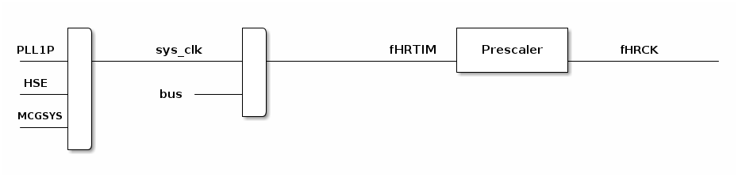

# __Example: *ll_hrtim_basic_pwm_master*__

**Example version:** 2.0.0

How to configure the HRTIM peripheral to generate a PWM waveform using the master timer.
The PWM waveforms generated by the HRTIM output channels can be displayed using an oscilloscope.

## __1. Detailed scenario__

This scenario demonstrates how the HRTIM master timer can generate a PWM signal, alongside a PWM signal generated by a timing unit.
Two outputs of the same timing unit are used: one output is driven by the master timer events, while the other output is driven by the timing unit events.
The master-driven output runs at 101 kHz with a 50% duty cycle, while the timing-unit-driven output runs at 100 kHz with a 50% duty cycle. The frequencies are intentionally set to slightly different values to ease visualization on an oscilloscope and to show that the two signals are asynchronous.

__Initialization phase__: At main program start, the `mx_system_init()` function is called. It initializes the peripherals, nonvolatile memory (such as flash memory, NVM, or external memories), MPU regions (if applicable), the system clock, and the SysTick.

The application executes the following __example steps__:

__Step 1__: Initializes the input clock, counter clock, and output clock of the HRTIM master timer and timing unit. Sets the master timer output to 101 kHz with a 50% duty cycle and the timing unit output to 100 kHz with a 50% duty cycle, then configures the GPIO pins.

__Step 2__: Starts the master timer and the timing unit PWM generation on the HRTIM outputs.

__End of example__: If no error occurs, the PWM signals are generated indefinitely.

## __2. Example configuration__

### __2.1. Timer configuration__

The *HRTIM* is configured as follows:

- The HRTIM master timer and timing unit are configured in continuous (free-running) and up counting modes.
- The master timer prescaler, period and compare unit are configured to generate a 101 kHz PWM signal with a 50% duty cycle.
- The timing unit prescaler, period and compare unit are configured to generate a 100 kHz PWM signal with a 50% duty cycle.
- For the HRTIM output channels, the output active level is HIGH. The PWM duty cycle is configured through counter set and reset events. One output is set/reset by the master timer events, the other by the timing unit events.

Note that the HRTIM timer configuration depends on the HRTIM peripheral input clock, which is derived from the system clock tree.
So, it is required to define the system clock configuration and to determine the HRTIM timer input clock before defining the HRTIM timer and output channel configuration.

The system clock configuration is specific to each STM32 MCU (see section [Hardware environment and setup](#3-hardware-environment-and-setup)).

### __2.2. GPIO configuration__

The GPIO pin is configured in:

- Alternate function as a HRTIM output channel of its respective timer instance.
- Push-pull mode with no pull-up or pull-down resistors activated.

## __3. Hardware environment and setup__

### __3.1. Generic Setup__

The PWM signals generated by the master timer and the timing unit can be displayed by connecting an oscilloscope to the corresponding board connectors.

### __3.2. Specific board setups__

  
On STM32H7P series.

  

    
Common configuration.

  To provide the high resolution, the HRTIM must be fed directly by the PLL high-frequency output.

  Each timer in the HRTIM has its own individual clock prescaler, which is used to adjust the timer high-resolution clock fHRCK.

  Standard STM32H7Pxx HRTIM clock distribution diagram:
<!--
@startuml
@startditaa{doc/stm32h7p_hrtim_peripheral_clock.png}

      ++-\                  +--\                       +-------------+
      +  |                  |  |                       |             |
PLL1P |  |       sys_clk    |  |               fHRTIM  |  Prescaler  |      fHRCK
---+--+  +------------------+  +----------+------------+             +-------------------
      |  |                  |  |                       +-------------+
 HSE  |  |                  |  |
---+--+  |        bus ---+--+  |
      |  |                  |  |
MCGSYS|  |                  +--/
---+--+  |
      |  |
      +--/

/--------------------------------------------------------------------------------------\
| sys_clk     system clock                                                             |
| fHRTIM      main HRTIM clock (hrtim_ker_ck)                                          |
| prescaler   individual clock prescaler per timer used to adjust the timer resolution |
| fHRCK       timer high-resolution equivalent clock                                   |
\--------------------------------------------------------------------------------------+

@endditaa
@enduml
-->

  

In this configuration:

- The sys_clk is set to 520 MHz.
- The HRTIM1 kernel clock is fed directly by sys_clk. The BMPRE prescaler (set to 2) applies only to the AHB/APB bus matrix, not to the HRTIM, so fHRTIM = 520 MHz.
- fHRTIM: set to 520MHz.
- fHRCK: set to 520MHz (prescaler = 1).

The master timer and the timing unit prescalers are set to 1. They must be identical because the master timer controls a Timer F output, so their CKPSC[2:0] values have to match.
To get the target PWM signals with a 520 MHz input clock, the periods are calculated as PER = fHRCK / fPWM:
Master timer (101 kHz): `PER = 520MHz / 101 kHz = 5148`
Timing unit (100 kHz): `PER = 520MHz / 100 kHz = 5200`

The duty cycle is obtained by multiplying the period by the duty cycle: PER x DC. The resulting numbers are HRTIM compare register values used as compare thresholds:
Master timer 50%: `PER * DC = 5148 * 0.5 = 2574`
Timing unit 50%: `PER * DC = 5200 * 0.5 = 2600`

The PWM waveforms are elaborated in the set/reset crossbar events on the HRTIM output channels:
HRTIM1_CHF1: set on Timer F period (TIMF_PERIOD), reset on Timer F compare unit1 (TIMF_CMP1). This gives the 100 kHz, 50% duty cycle output driven by the timing unit.
HRTIM1_CHF2: set on master timer period (MASTER_PERIOD), reset on master timer compare unit1 (MASTER_CMP1). This gives the 101 kHz, 50% duty cycle output driven by the master timer.

  

  

    
On board NUCLEO-H7P5II.

  The selected timers are the master timer and TIMF, with :
  HRTIM1_CHF1 driven by Timer F (timing unit output).
  HRTIM1_CHF2 driven by the master timer (master output).

  | Board connector   and pin  | CPU pin | Signal name    | ARDUINO   connector pin |
  | :---:                        | :---:   | :---:          | :---:                     |
  | CN9_8                        | PC6     | HRTIM1_CHF1    |   ARDUINO CONNECTOR - D7  |
  | CN9_3                        | PC7     | HRTIM1_CHF2    |   ARDUINO CONNECTOR - D2  |

  

  

    
On board STM32H7P5I-DK.

  The selected timers are the master timer and TIMF, with :
  HRTIM1_CHF1 driven by Timer F (timing unit output).
  HRTIM1_CHF2 driven by the master timer (master output).

  | Board connector   and pin  | CPU pin | Signal name    | ARDUINO   connector pin |
  | :---:                        | :---:   | :---:          | :---:                     |
  | CN9_8                        | PC6     | HRTIM1_CHF1    |   ARDUINO CONNECTOR - D7  |
  | CN9_3                        | PC7     | HRTIM1_CHF2    |   ARDUINO CONNECTOR - D2  |

  

## __4. Troubleshooting__

Here are the points of attention for this specific example:

__System clock__:

- To provide the high resolution, the HRTIM must be fed directly by the PLL high-frequency output.
- The HRTIM clock depends on the system clock configuration. Changing the CPU clock or the peripheral bus' clock affects the PWM frequency and duty cycle.

__GPIO slew rate__:

The GPIO slew rate is an important parameter that affects the performance of high-frequency signals. Refer to the AN4899 application note in case of issues.

## __5. See Also__

This [HRTIM cookbook (ref. AN4539)](https://www.st.com/content/ccc/resource/technical/document/application_note/13/d6/48/9d/11/11/4c/08/DM00121475.pdf/files/DM00121475.pdf/jcr:content/translations/en.DM00121475.pdf) presents an overview of the HRTIM peripheral for the STM32 product series and a collection of examples.

You can also refer to these other examples:

- ll_hrtim_basic_single_pwm: demonstrates how to use the HRTIM peripheral in continuous mode to generate a 100 kHz PWM signal with a 50% duty cycle.
- ll_hrtim_basic_multiple_pwm: demonstrates how to use the HRTIM peripheral in continuous mode to generate PWM waveforms on multiple outputs.

More information about the STM32 ecosystem can be found in the [STM32 MCU Developer Zone](https://www.st.com/content/st_com/en/stm32-mcu-developer-zone/embedded-software.html).

## __6. License__

Copyright (c) 2026 STMicroelectronics.

This software is licensed under terms that can be found in the LICENSE file in the root directory
of this software component.
If no LICENSE file comes with this software, it is provided AS-IS.
