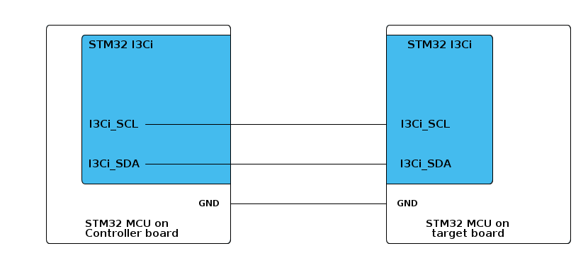

# __Example: *ll_i3c_wakeup_from_stop_target*__

**Example version:** 2.0.0

How to wake up the STM32 target from STOP mode on the I3C bus with the LL API.

**Note that the terminology Controller/Target characterizes the role taken by each device in the I3C communication and replaces the legacy naming previously used on the bus.**

## __1. Detailed scenario__

This example shows how the STM32 target wakes from STOP mode with dynamic address assignment, using the I3C protocol.

__Initialization phase__: At main program start, the `mx_system_init()` function is called. It initializes the peripherals, nonvolatile memory (such as flash memory, NVM, or external memories), MPU regions (if applicable), the system clock, and the SysTick.

The application executes the following __example steps__:

__Step 1__: The initialization of the I3C instance is triggered by the application code. The LL helper layer activates the I3C target instance.

__Step 2__: Perform dynamic address assignment. This step activates the notification, waits for address assignment completion, and checks the assigned address.

__Step 3__: After dynamic address assignment completes, the target starts a receive operation in interrupt mode and enters STOP mode, waiting for a command from the controller.

__Step 4__: After wake-up from STOP mode, the MCU waits for either receive complete or error event.

__Step 5__: After reception, the target starts a transmit operation in interrupt mode to echo the received buffer back to the controller.

__Step 6__: The MCU waits for transmit complete or error event. On success, the process can end or repeat (up to the configured retry limit).

The communication status is reported via the status LED and the variable ExecStatus.

__End of example__: The scenario ends when successful communication is completed or after the maximum number of retries is reached.

## __2. Example configuration__

This example demonstrates the following peripherals.

__I3C__: is configured as indicated below:

- The controller assigns a dynamic address (default: 0x32) to the target during ENTDAA.

- The bus usage, including the I3C bus and its duty cycle timings, is calculated by STM32CubeMX2 in accordance with the I3C initialization section of the reference manual.

- The I3C bus is configured to run at the maximum supported speed to demonstrate its highest performance.
  See `__I3C maximum speed__` in section [3.2 Specific board setups](#32-specific-board-setups).
- The event and error interrupts of the I3C instance are configured and enabled in the NVIC.

To test this example with the controller, you can use the corresponding *ll_i3c_private_it_controller* example pack.

## __3. Hardware environment and setup__

### __3.1. Generic Setup__

- The controller board is connected to the target board through the two I3C lines and a common GND.

<!--
@startuml
@startditaa{doc/example_ll_i3c_wakeup_from_stop_target-setup.png} -E -S
    /-------------------------\                     /-------------------------\
    |    /--------------------+                     +--------------\          |
    |    |STM32 I3Ci          |                     |  STM32 I3Ci  |          |
    |    |                    |                     |              |          |
    |    |                    |                     |              |          |
    |    |                    |                     |              |          |
    |    |                    |                     |              |          |
    |    |                    |                     |              |          |
    |    |                    |                     |              |          |
    |    |                    |                     |              |          |
    |    |                    |                     |              |          |
    |    |I3Ci_SCL------------+---------------------+ I3Ci_SCL     |          |
    |    |                    |                     |              |          |
    |    |                    |                     |              |          |
    |    |                    |                     |              |          |
    |    |I3Ci_SDA------------+---------------------+ I3Ci_SDA     |          |
    |    |               c4BE |                     |       c4BE   |          |
    |    \--------------------+                     +--------------/          |
    |                         |                     |                         |
    |                     GND +---------------------+ GND                     |
    |                         |                     |                         |
    |     STM32 MCU on        |                     |     STM32 MCU on        |
    |     Controller board    |                     |     target board        |
    \-------------------------/                     \-------------------------/

@endditaa
@endumldd
-->

### __3.2. Specific board setups__

The I3C serial clock (SCL) and data (SDA) lines can be observed by connecting an oscilloscope or a logic analyzer to the corresponding board connectors.

This section describes the exact hardware configurations of your project.

  
On STM32H7P series.

  

    
On board NUCLEO-H7P5II.

  |  MCU pin  |  Signal name  |  User Label   |
  |:---------:|:-------------:|:-------------:|
  |    PC8    |   I3C1_SCL    |       -       |
  |    PC9    |   I3C1_SDA    |       -       |
  |    PG9    |     GPIO      | MX_STATUS_LED |

  

  

    
On board STM32H7P5I-DK.

  |  MCU pin  |  Signal name  |  User Label   |
  |:---------:|:-------------:|:-------------:|
  |    PI2    |   I3C1_SCL    |       -       |
  |    PB8    |   I3C1_SDA    |       -       |
  |    PH6    |     GPIO      | MX_STATUS_LED |

  

## __4. Troubleshooting__

Here are the points of attention for this specific example:

  1. __Dynamic Address Assignment__: Address assignment is started by the controller using the `ENTDAA` command, one of the I3C Common Command Codes (CCC), standard broadcast commands used to manage devices on the bus. The controller enumerates each target, which responds with its identification payload (PID, BCR, DCR). The controller then assigns a unique dynamic address to each target, which is used for all further private transfers.
  In this example, address assignment completion and address verification are handled via interrupts (see Step 2).

  2. If there are no I3C signals observed, remember to check these points first:
     - The GND pins of the controller and target boards are connected.
     - Use the shortest possible wires between the boards to improve signal integrity.

  3. For correct synchronization, always run the target application before running the controller. This ensures the target is ready to respond to the controller's address assignment request.

### __4.1. Notes__

The following notes are specific to this example:

- Target wakeup latency can delay private transfer readiness. Enable controller RX stall (MIPI-compliant, RX stall only).
- A timing mismatch during target low-power entry can cause late low-power entry after transfer completion.

__Error handling__: In LL examples, error handling is controlled by the USE_LL_APP_ERROR constant in the application files. This compilation flag is disabled by default. If the example does not behave as expected, enable error handling for debugging by setting USE_LL_APP_ERROR to 1 in ll_example.h.

## __5. See Also__

- You can find the application note AN5879 related to the I3C MANUAL on the [AN5879](https://www.st.com/resource/en/application_note/an5879-introduction-to-i3c-for-stm32-mcus-stmicroelectronics.pdf) website if you want to go further on some technical details of the I3C bus

The documentation of the drivers of the relevant STM32 series contains more detailed information.

For instance for the STM32C5 series: [HAL documentation](https://dev.st.com/stm32cube-docs/stm32c5xx-hal-drivers/latest/en/index.html).

More information about the STM32 ecosystem can be found in the [STM32 MCU Developer Zone](https://www.st.com/content/st_com/en/stm32-mcu-developer-zone/embedded-software.html).

## __6. License__

Copyright (c) 2026 STMicroelectronics.

This software is licensed under terms that can be found in the LICENSE file in the root directory
of this software component.
If no LICENSE file comes with this software, it is provided AS-IS.
