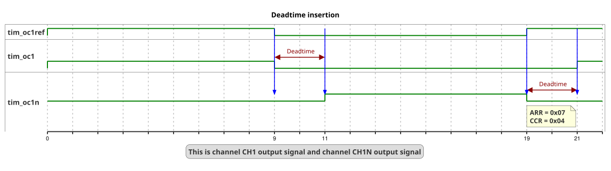
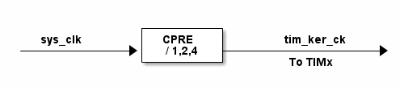

# __Example: *ll_tim_break_and_deadtime*__

**Example version:** 2.0.6

How to configure the TIM peripheral to generate two complementary PWM (Pulse Width Modulation) signals with symmetric deadtime insertion.

## __1. Detailed scenario__

This scenario demonstrates how to configure the TIM peripheral to generate two complementary PWM (Pulse Width Modulation) signals with symmetric deadtime insertion. Deadtime is a short period inserted between the switching of the high and low signals to prevent short circuits and reduce switching losses in power electronics.

__Initialization phase__: At main program start, the `mx_system_init()` function is called. It initializes the peripherals, nonvolatile memory (such as flash memory, NVM, or external memories), MPU regions (if applicable), the system clock, and the SysTick.

The application executes the following __example steps__:

__Step 1__: Initializes the timer peripheral with deadtime insertion feature.

__Step 2__: Starts the timer peripheral to generate a PWM with deadtime insertion.

__End of example__: If no error occurs, the PWM signal is generated indefinitely.

You can verify that the example runs properly via the status LED and the `ExecStatus` variable.

## __2. Example configuration__

### __2.1. Timer configuration__

The goal is to use TIM peripheral to generate a symmetric PWM signal with deadtime insertion on channel 1X and its complementary channel 1XN.

The *TIM* is configured as follows:

- The timer is configured as a PWM generator in up-counting mode.
- The timer is configured with symmetrical deadtime.
- The deadtime value is set to 3.7 microseconds.
- The timer prescaler is configured to set the timer counter clock to 64 kHz.
- The PWM duty cycle is initially configured at 50% for both channels. However, the real duty cycle is lower due to deadtime insertion, resulting in an actual duty cycle of 47%.
- The PWM frequency is configured at 8 kHz.

To obtain 8kHz as PWM frequency, the ARR value is chosen as indicated below:

    PWM period = tim_cnt_ck period * (ARR + 1)
    PWM frequency = tim_cnt_ck frequency / (ARR + 1)
    ARR = (tim_cnt_ck frequency / PWM frequency) - 1
    ARR = (64 kHz / 8 kHz) - 1
    ARR = 7

The PWM duty cycle, expressed as a percentage, is calculated as the ratio of the output active state to the PWM period, multiplied by 100:

    duty_cycle_percent = (CCR / (ARR + 1)) * 100
    CCR = (duty_cyle_percent * (ARR + 1)) / 100
    CCR = (50 * (7 + 1)) / 100
    CCR = 4

To obtain a duty cycle of 47% after accounting for deadtime:

    PWM period = 1 / PWM frequency
    PWM period = 1 / 8 kHz = 125 us
    Initial_pulse_duration = 50% of 125 us
    Effective pulse duration = Initial_pulse_duration - deadtime value
    Effective_pulse_duration = 62.5 us - 3.7 us = 58.8 us.
    Actual_duty_cycle = ( Effective_pulse_duration / Period ) * 100.
    Actual_duty_cycle = ( 58.8 us / 125 us ) * 100
    Actual_duty_cycle = 47 %

In this example, the timer is configured with symmetrical deadtime. The deadtime value is 3.7us. This configuration is applied to the PWM signal on channel 1X and its complementary channel 1XN.

The deadtime value configured correspond to DTG (Dead time generator) bitfield of TIMx_BDTR register. This value, which is not a time unit, can be computed as below.

The system clock configuration is specific to each STM32 MCU (see section [Hardware environment and setup](#3-hardware-environment-and-setup)).

### __2.2. GPIO configuration__

Two pins must be configured, one for each PWM signal: [see the specific boards setups](#32-specific-board-setups)

The GPIO pins are configured in:

- Alternate function as a timer channel of the same timer instance
- Push-pull mode with no pull-up or pull-down resistors activated.

## __3. Hardware environment and setup__

### __3.1. Generic Setup__

The PWM signals generated by the timer channels can be displayed by connecting an oscilloscope to the corresponding board connectors.

### __3.2. Specific board setups__

  
On STM32H7P series.

  

    
Common configuration.

  Timer's counter clock configuration:

  - The timer's internal input clock (tim_ker_ck) depends on the system clock (sys_clk) according to this formula:
      tim_ker_ck = sys_clk / CPRE
      With CPRE the CPU domain core prescaler.

      So, tim_ker_ck = sys_clk / CPRE in Hz

  To obtain the timer's counter clock frequency (tim_cnt_ck), the timer prescaler register (TIM_PSC) is computed as follows:

      TIM_PSC = ( (sys_clk / CPRE) / tim_cnt_ck ) - 1

  Standard STM32H7Pxx timer clock distribution diagram:
    <!--
@startuml
@startditaa{doc/stm32h7pxx_peripherals_clocks.png}

               +---------+
  sys_clk      |  CPRE   |      tim_ker_ck
------------+->+ / 1,2,4 +-----------------+->
               +---------+       To TIMx

@endditaa
@enduml
-->
  

In this configuration:

- The sys_clk is set to 520 MHz.
- The CPRE prescaler is set to 1 so the tim_ker_ck = 520 MHz.

As we want the timer counter clock equal to 64 kHz, the timer prescaler must be:

      timer_prescaler = (520 MHz / 64 kHz) - 1 = 8124

  

  

    
On board NUCLEO-H7P5II.

  |  MCU pin  |  Signal name  |  User Label   |
  |:---------:|:-------------:|:-------------:|
  |    PC6    |   TIM8_CH1    |       -       |
  |   PA10    |   TIM8_CH1N   |       -       |
  |    PG9    |     GPIO      | MX_STATUS_LED |

  The selected timer is TIM8, with:

  - TIM8_CH1 for channel 1
  - TIM8_CH1N for the complementary channel

  Board connector mapping:

      - TIM8_CH1: PC6 (CN9-8 / ARDUINO D7)
      - TIM8_CH1N: PA10 (CN9-6 / ARDUINO D5)

  

  

    
On board STM32H7P5I-DK.

  |  MCU pin  |  Signal name  |  User Label   |
  |:---------:|:-------------:|:-------------:|
  |    PI2    |   TIM20_CH4   |       -       |
  |    PB8    |  TIM20_CH4N   |       -       |
  |    PH6    |     GPIO      | MX_STATUS_LED |

  

## __4. Troubleshooting__

Here are the points of attention for this specific example:

__System clock__: The timer clock depends on the system clock configuration. Changing the CPU clock or the peripheral bus' clock affects the PWM frequency.

## __5. See Also__

This [General-purpose timer cookbook for STM32 microcontrollers (ref. AN4776)](https://www.st.com/content/ccc/resource/technical/document/application_note/group0/91/01/84/3f/7c/67/41/3f/DM00236305/files/DM00236305.pdf/jcr:content/translations/en.DM00236305.pdf) provides a simple and clear description of the basic features and operating modes of the STM32 general-purpose timer peripherals.

This [STM32 cross-series timer overview (ref. AN4013)](https://www.st.com/content/ccc/resource/technical/document/application_note/54/0f/67/eb/47/34/45/40/DM00042534.pdf/files/DM00042534.pdf/jcr:content/translations/en.DM00042534.pdf) presents an overview of the timer peripherals for the STM32 product series.

More information about the STM32Cube Drivers can be found in the drivers' user manual of the STM32 series you are using.

You can also refer to this other example:

- hal_tim_deadtime_insertion: generate two complementary PWM signals with symmetric deadtime insertion.

More information about the STM32 ecosystem can be found in the [STM32 MCU Developer Zone](https://www.st.com/content/st_com/en/stm32-mcu-developer-zone/embedded-software.html).

## __6. License__

Copyright (c) 2026 STMicroelectronics.

This software is licensed under terms that can be found in the LICENSE file in the root directory
of this software component.
If no LICENSE file comes with this software, it is provided AS-IS.
