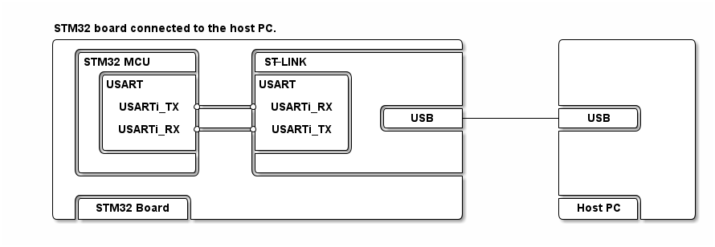

# __Example: *ll_uart_reception_to_idle_circular_dma*__

**Example version:** 2.0.0

How to receive UART data in circular DMA mode until either the programmed buffer is full or an IDLE event occurs, using the LL API.

## __1. Detailed scenario__

This example demonstrates UART transmission in blocking mode and UART reception to IDLE event in circular DMA mode between a board and a serial terminal emulator PC application.

In this example, the CPU and the DMA share the reception buffer. On STM32 devices with the data cache enabled, this shared buffer must remain non-cacheable because this scenario does not include explicit cache maintenance operations. To do so, the reception buffer and the DMA linked-list node are placed in the `.non_cacheable_variables` memory section and the appropriate MPU settings are applied during system initialization in `mx_system_init()`.

__Initialization phase__: At main program start, the `mx_system_init()` function is called. It initializes the peripherals, the MPU regions, the system clock, and the SysTick.

The application executes the following __example steps__:

__Step 1__: Configures and initializes the UART instance.

__Step 2__: Sends an information message to the user through the serial terminal.

__Step 3__: Starts continuous data reception with a circular DMA linked list. The DMA keeps filling the reception buffer and the UART signals an event either when the full buffer has been received or when an IDLE condition is detected on the Rx line.

__Step 4__: Waits for one of these events: a UART IDLE interrupt, a DMA transfer complete interrupt, or a transfer error.

__Step 5__: Copies the newly received data chunk into a user buffer and sends it back on UART Tx.
            Returns to step 2 indefinitely if no error occurs.

__End of example__: The example loops endlessly while transfers succeed. If the maximum number of communication attempts is reached during one processing round, an error status is reported to the main function.

The communication status is reported via the status LED and the `ExecStatus` variable.

## __2. Example configuration__

The example demonstrates the following peripherals:

__UART__:

The UART is configured with the following settings:

- The baud rate is set to 115200.
- The word length is set to 8 bits.
- Stop bits are set to 1 bit.
- Parity is set to NONE.

<!--
@startuml
@startditaa{doc/ASCII_data_frame.png}

    The UART data frame of the current configuration:

      /--------------------------------------\
      |  /------+-----------------+-------\  |
      |  |  SB  |   8 bits data   |  STB  |  |
      |  \------+-----------------+-------/  |
      \--------------------------------------/

      /---------------\
      | SB:  Start Bit|
      | STB: Stop Bit |
      \=--------------/
@endditaa
@enduml
-->

__DMA__:

The DMA peripheral is used to manage UART Rx transfers.

The DMA receive channel is configured in peripheral-to-memory mode with a fixed source address and an incremented destination address. The data is loaded from the UART receive data register to SRAM through a single self-linked circular DMA node, so the write pointer rolls over automatically when the end of the buffer is reached.

The DMA receive channel NVIC line is configured and enabled.

__IDLE Process__:

It allows the UART to receive data continuously until an IDLE line detection occurs, which corresponds to a pause on the RX line longer than one UART frame.

For the current UART configuration:

- Total bits per frame: 1 start bit + 8 data bits + 1 stop bit = 10 bits.
- Baud rate: 115200.
- Frame time: 10 / 115200 = 86.8 us.

The time between two keyboard strokes is typically much longer than a single frame time. As a consequence, the UART usually detects an IDLE condition after each burst of characters entered on the terminal.

## __3. Hardware environment and setup__

### __3.1. Generic Setup__

This section describes the hardware setup principles that apply to any board.

Select the STM32 UART instance connected to the embedded ST-LINK on your board. The ST-LINK provides a virtual COM port over USB, which is mounted on the host PC and ready for use with a terminal emulator.

<!--
@startuml
@startditaa{doc/ASCII_Board_PC.png}

STM32 board connected to the host PC.

    /--------------------------------------------------\           /----------------\
    |  /--------------\      /-------------------------+           |                |
    |  |STM32 MCU     |      |ST-LINK                  |           |                |
    |  |  /-----------+      +-----------\             |           |                |
    |  |  |USART      |      |USART      |             |           |                |
    |  |  |           |      |           |             |           |                |
    |  |  | USARTi_TX *------* USARTi_RX |   /---------+           +---------\      |
    |  |  |           |      |           |   |   USB   +-----------+   USB   |      |
    |  |  | USARTi_RX *------* USARTi_TX |   \---------+           +---------/      |
    |  |  |           |      |           |             |           |                |
    |  |  \-----------+      +-----------/             |           |                |
    |  |              |      |                         |           |                |
    |  \--------------/      \-------------------------+           |                |
    |                                                  |           |                |
    |  /-------------\                                 |           +---------\      |
    |  | STM32 Board |                                 |           | Host PC |      |
    \--+-------------+---------------------------------/           \---------+------/
@endditaa
@enduml
-->

### __3.2. Specific board setups__

This section describes the exact hardware configurations of your project.

  
On STM32H7P series.

  

    
On board NUCLEO-H7P5II.

  |  MCU pin  |  Signal name  |  User Label   |
  |:---------:|:-------------:|:-------------:|
  |    PA3    |   USART2_RX   |       -       |
  |    PA2    |   USART2_TX   |       -       |
  |    PG9    |     GPIO      | MX_STATUS_LED |

  

  

    
On board STM32H7P5I-DK.

  |  MCU pin  |  Signal name  |  User Label   |
  |:---------:|:-------------:|:-------------:|
  |    PA3    |   USART2_RX   |       -       |
  |    PA2    |   USART2_TX   |       -       |
  |    PH6    |     GPIO      | MX_STATUS_LED |

  

## __4. Troubleshooting__

Find below the points of attention for this specific example.

__Host PC settings__: Configure your terminal emulator with the following settings:

1. Set the UART parameters to match the required configuration.
2. Ensure the stop bits are correctly set, considering whether they are included in the data length.
3. Local echo is enabled, so that you can see the characters you type.

__Reception behavior__: This example reacts to an IDLE condition on the UART RX line. You do not need to press Enter. Any pause between two bursts of characters may terminate the current DMA chunk and trigger the loopback.

__Error handling__: In LL examples, error handling is controlled by the `USE_LL_APP_ERROR` constant in `application/ll_example.h` to reduce code footprint. This compilation flag is disabled by default. If the example does not behave as expected, enable error handling for debugging by setting `USE_LL_APP_ERROR` to 1.

__Implementation note__: The application layer relies directly on the generated `MX_UARTx` aliases from STM32CubeMX2, while the DMA linked-list channel binding stays local to the LL helper source file.

## __5. See Also__

You can also refer to these examples and utility to go further with the UART peripheral:

- hal_uart_reception_to_idle_circular_dma: the HAL counterpart of this scenario.
- ll_uart_echo_dma: UART transmission and reception in DMA mode with a terminal emulator.
- ll_uart_echo_it: UART transmission and reception in interrupt mode with a terminal emulator.

More information about the STM32Cube Drivers can be found in the drivers' user manual of the STM32 series you are using.

## __6. License__

Copyright (c) 2026 STMicroelectronics.

This software is licensed under terms that can be found in the LICENSE file in the root directory of this software component.
If no LICENSE file comes with this software, it is provided AS-IS.
