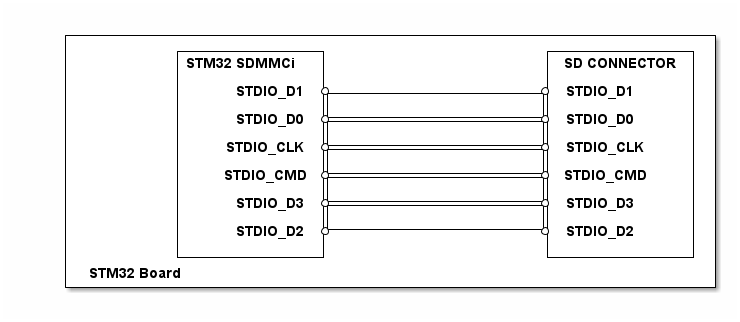

# __Example: *filex_fw_update_usd_no_os*__

**Example version:** 2.0.0

This application provides an example of FileX stack, it implements an In-Application programming demonstrating FileX's SD file access capabilities.
The application is designed to erase and write to on-chip flash memory, it provides all required software code for handling SD card and flash memory I/O operations.

This is a typical application on how to use the SD card peripheral for firmware upgrade application, allowing user to erase and write to on-chip flash memory.

The application starts by checking the state of the user button (BUTTON_USER), and depending on its state the application will enter one of the two startup sequences:

If the user button is pressed at application start-up, the program try to flash a new software, loaded from the SD card, to the flash memory as below:

  - initialize the SD card driver
  - open the SD card media and look for the first file with the .BIN extension to be loaded.
  - go over the file and program it into flash, 32 bytes a time
  - upon completion, the Application will enter an infinite loop to light the MX_STATUS_LED, marking the success of the flashing operation.

<b> Notes:</b>

  - The flash address for programming is defined by the flag **USER_APP_ADDRESS**.
  - Ensure that the loaded application is linked to the same flash start address as **USER_APP_ADDRESS**.
  - Both the Vector Table and the ROM start address must be set accordingly and must not overlap with the fw_update_usd_no_os application memory regions.
  - A power cycle or depressing the reset button is required in order to exit the programming mode.

If the user button is found unpressed within application start-up, the program will try to load the previously programmed application from the address defined by **USER_APP_ADDRESS**.

For that the steps below will be followed:

  - signature of the to-be loaded application is checked prior of its starting to check if the it was already programmed starting at the previously mentioned address
  - call to the function **CallUserApp** to de-initialize all the previously initialized resources in the fw_update_usd_no_os application
  - vector table and Stack pointer are set to point to the ones defined by the loaded application
  - the Program Counter is also updated
  - the call to the loaded application is made
  - control is then handed over to the new application which should start.

<b>Note</b>:

  - A FAT32 compatible SD card is expected to be used in this example.
  - Firmware of the loaded application must be located at the root of A FAT32 compatible SD card, the format must be raw binary.
  - The program will start file operations without formatting the media, so all user related files are kept.
  - Ensure to place the binary file on the microSD card before starting the application.

## __1. Detailed scenario__

__Initialization phase__: At the beginning of the main program, the `mx_system_init()` function is called to initialize the peripherals, the Flash interface, the system clock, and the systick.

The application executes the following __example steps__:

- __Step 1__: Initialize the application and check that the user button is pressed.
- __Step 2__: Initializes FileX.
- __Step 3__: Programs, the flash memory by indicating the address, the data to be programmed and its size.
__End of example__: After Step 3, the example si completed. You can check its status via the MX_STATUS_LED.

## __2. Example configuration__

- *SD*: is configured with the following features and settings:
  - rising edge detection
  - clock power save disabled
  - bus wide of 4 bits
  - hardware flow control disabled
  - no transceiver
  - maximum data timeout
  - maximum transfer timeout
  - maximum erase timeout
  - selected gpio pins support the SD alternate function. They are configured in push-pull mode with no pull-up or
  pull-down.

## __3. Hardware environment and setup__

### __3.1. Generic Setup__

Please find below the hardware setup principle that applies to any board.

plantUML ditaa integration supports PNG only

@startuml
@startditaa{doc/ASCII_sd_connection.png}
+---------------------------------------------------------------- +
|          +-------------- +                     +-------------- + |
|          | STM32 SDMMC  |                     | SD CONNECTOR | |
|          |              |                     |              | |
|          |     STDIO_D1 *-------------------- -* STDIO_D1     | |
|          |              |                     |              | |
|          |     STDIO_D0 *-------------------- -* STDIO_D0     | |
|          |              |                     |              | |
|          |    STDIO_CLK *-------------------- -* STDIO_CLK    | |
|          |              |                     |              | |
|          |    STDIO_CMD *-------------------- -* STDIO_CMD    | |
|          |              |                     |              | |
|          |     STDIO_D3 *-------------------- -* STDIO_D3     | |
|          |              |                     |              | |
|          |     STDIO_D2 *-------------------- -* STDIO_D2     | |
|          |              |                     |              | |
|          +-------------- +                     +-------------- + |
| STM32 Board                                                    |
+---------------------------------------------------------------- +
@endditaa
@enduml

### __3.2. Specific board setups__

The different signals used for the SDMMC can be observed by connecting an oscilloscope or a logical analyser to the
corresponding board connectors.

Please find the exact hardware configurations of your project below.

On STM32H7P series.

On board STM32H7P5I-DK.

| Board connector  | MCU pin  | Signal name  | ARDUINO   connector pin |
| :--------------: | :------: | :----------: | :------------------------: |
|         NA       |   PE3    |  SDMMC1_D0   |             NA             |
|         NA       |   PE4    |  SDMMC1_D1   |             NA             |
|         NA       |   PE5    |  SDMMC1_D2   |             NA             |
|         NA       |   PE6    |  SDMMC1_D3   |             NA             |
|         NA       |   PE2    |  SDMMC1_CK   |             NA             |
|         NA       |   PA5    |  SDMMC1_CMD  |             NA             |

## __4. Troubleshooting__

## __5. See Also__

## __6. License__

Copyright (c) 2026 STMicroelectronics.

This software is licensed under terms that can be found in the LICENSE file in the root directory
of this software component.
If no LICENSE file comes with this software, it is provided AS-IS.
