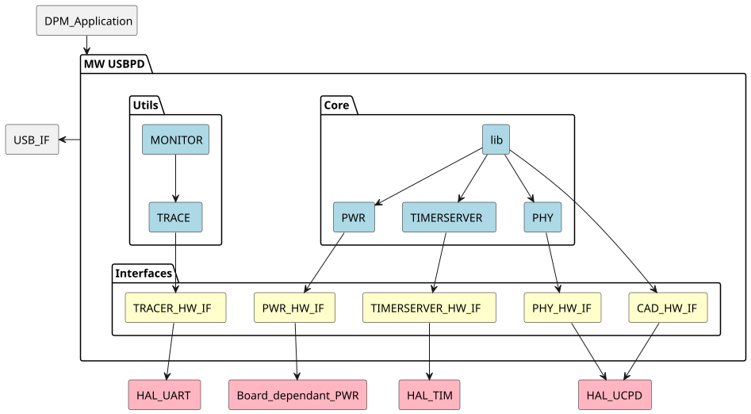

# __Example: *usbpd_sink_pd_freertos*__

**Example version:** 2.0.0

How to configure a USB Type-C Power Delivery Sink with FreeRTOS based on the USBPD stack.

## __1. Detailed scenario__

__Initialization phase__: At main program start, the `mx_system_init()` function is called. It initializes the peripherals, nonvolatile memory (such as flash memory, NVM, or external memories), MPU regions (if applicable), the system clock, and the SysTick.

The application executes the following __example steps__:

- __Step 1__: Initialization of USBPD stack: DPM and DPM User.
              This step initializes the USBPD stack (CAD and PE layers), and create tasks for the both CAD and PE layers.

- __Step 2__: Starts the FreeRTOS scheduler.
              The USBPD tasks are executed by the FreeRTOS scheduler.

__End of example__: This is an endless example that does not stop unless an error occurs.

In case of successful operations:

- Status LED remains turned on
- Global variable `ExecStatus` set to EXEC_STATUS_INIT_OK

- Connect the USB Type-C cable to the USB Type-C port of the board.
- USBPD trace is displayed in STM32CubeMonitor-UCPD when connecting or disconnecting a USB Type-C cable to the USB Type-C port of the board. This cable must be connected to a USB Type-C source, or a legacy USB Type-A source with a USB Type-C to USB Type-A cable.

In case of failure:

- Status LED toggle infinitely
- Global variable `ExecStatus` set to EXEC_STATUS_ERROR

When using Keil(AC6), the usage of flag -fshort-enums is required for compatibility with USBPD library.

## __2. Example configuration__

This example uses the following peripheral(s):

  - UCPD
  - GPIO
  - TIM
  - ADC
  - DMA
  - USART
  - EXTI

### __2.1. Block Diagram__

This example is based on the USBPD stack. The USBPD stack is defined with the following architecture:

## __3. Hardware environment and setup__

### __3.1. Generic Setup__

This section describes the hardware setup principles that apply to any board.

Connect the USB Type-C cable to the USB Type-C port of the board. This cable must be connected to a USB Type-C source, or a legacy USB Type-A source with a USB Type-C to USB Type-A cable.

### __3.2. Specific board setups__

This section describes the exact hardware configurations of your project.

  
On STM32H7P series.

  

    
On board NUCLEO-H7P5II.

  |  MCU pin  |  Signal name  |  User Label   |
  |:---------:|:-------------:|:-------------:|
  |    PG9    |     GPIO      | MX_STATUS_LED |
  |    PA8    |   UCPD1_CC1   |       -       |
  |    PA9    |   UCPD1_CC2   |       -       |
  |    PB6    |  UCPD1_DBCC1  |       -       |
  |    PB5    |  UCPD1_DBCC2  |       -       |
  |    PA2    |   USART2_TX   |       -       |
  |    PE9    |  ADC4_INP17   |       -       |
  |    PF0    |     GPIO      |       -       |
  |    PF5    |     GPIO      |       -       |

  

## __4. Troubleshooting__

Find below the points of attention for this specific example.

__USBPD Trace__: STM32CubeMonitor-UCPD can used to debug the USBPD stack.

## __5. See Also__

This [application note](https://www.st.com/resource/en/application_note/an5225-introduction-to-usb-typec-power-delivery-for-stm32-mcus-and-mpus-stmicroelectronics.pdf) and this [wiki article](https://wiki.st.com/stm32mcu/index.php?title=Introduction_to_USB_Power_Delivery_with_STM32&sfr=stm32mcu) explains further this USB Type-C Power Delivery feature.

More information can be found in the [STM32 solutions for USB Type-C and Power Delivery](https://www.st.com/content/st_com/en/ecosystems/stm32-usb-c.html) page.

The user manual of the drivers of the relevant STM32 series contains more detailed information.

More information about the STM32 ecosystem can be found in the [STM32 MCU Developer Zone](https://www.st.com/content/st_com/en/stm32-mcu-developer-zone/embedded-software.html).

## __6. License__

Copyright (c) 2026 STMicroelectronics.

This software is licensed under terms that can be found in the LICENSE file in the root directory
of this software component.
If no LICENSE file comes with this software, it is provided AS-IS.
