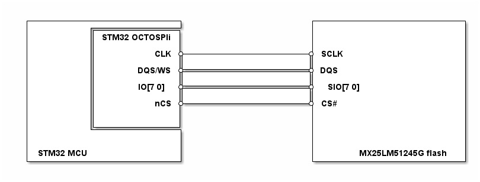

# __Example: *mx25lm51245g_read_write_dma*__

**Example version:** 2.0.0

[](https://dev.st.com/stm32cube-docs/examples/arch-v1/en/index.html "An offline version is also available in the STM32Cube firmware package.")

How to use the MX25LM51245G OCTOSPI memory using "read/write dma" APIs.
This example demonstrates writing to and reading from the flash memory using DMA in OPI mode with double transfer rate, with a preliminary sector erase to ensure the memory is properly prepared for subsequent operations.


## __1. Detailed scenario__

__Initialization phase__: At main program start, the `mx_system_init()` function is called. It initializes the peripherals, nonvolatile memory (such as flash memory, NVM, or external memories), MPU regions (if applicable), the system clock, and the SysTick.

The application executes the following __example steps__:

__Step 1__: The initialization of the MX25LM51245G part is triggered by the applicative code.

__Step 2__: Erase the memory pages by sectors, to ensure the memory is properly prepared for subsequent operations.

__Step 3__: Writes a data buffer to the external memory, in indirect mode using DMA (asynchronous transfer), using OPI mode with double transfer rate.

__Step 4__: Reads the same data buffer from the external memory using DMA (asynchronous transfer), and checks that it matches the buffer written in step 3.

__Step 5__: De-initializes the MX25LM51245G part.

__End of example__: After step 5, the example is completed. You can verify that the example runs properly via the status LED and the `ExecStatus` variable.

If you enable `USE_TRACE`, you can follow these execution steps in the terminal logs:

```text
[INFO] Step 1: Device initialization COMPLETED.
[INFO] Step 2: Memory erased (OPI DTR - Indirect mode).
[INFO] Step 3: Data buffer written to the external memory (OPI DTR - Indirect mode).
[INFO] Step 4: Data buffer read from the external memory and matching the initial value.
[INFO] Step 5: Device de-initialization.
```


## __2. Example configuration__

[](https://dev.st.com/stm32cube-docs/examples/arch-v1/en/configure/config_toc.html "An offline version is also available in the Cube firmware package.")

__XSPI__: The XSPI is configured with these specific parameters:

- The memory type is set to "HAL_XSPI_MEMORY_TYPE_MACRONIX."
- The CS boundary is set to "HAL_XSPI_CS_BOUNDARY_NONE."
- The memory mode is set to "HAL_XSPI_MEMORY_SINGLE."
- The memory wrap size is set to "HAL_XSPI_WRAP_NOT_SUPPORTED."
- The timing state is set to "HAL_XSPI_DLYB_ON."
- The chip select release time cycle and the refresh time cycle are set to 0.


## __3. Hardware environment and setup__

### __3.1. Generic Setup__

This section describes the hardware setup principles that apply to any board.

<!--
@startuml
@startditaa{doc/generic_hardware_setup.png}
  +-------------------------+                     +-------------------------+
  |          +--------------+                     |                         |
  |          |STM32 OCTOSPIi|                     |                         |
  |          |              |                     |                         |
  |          |          CLK *---------------------* SCLK                    |
  |          |              |                     |                         |
  |          |       DQS/WS *---------------------* DQS                     |
  |          |              |                     |                         |
  |          |      IO[7:0] *---------------------* SIO[7:0]                |
  |          |              |                     |                         |
  |          |          nCS *---------------------* CS#                     |
  |          |              |                     |                         |
  |          |              |                     |                         |
  |          +--------------+                     |                         |
  |                         |                     |                         |
  |                         |                     |                         |
  | STM32 MCU               |                     |      MX25LM51245G flash |
  +-------------------------+                     +-------------------------+
@endditaa
@enduml
-->



### __3.2. Specific board setups__

<details>
<summary>On STM32H7P series.</summary>
<details>
  <summary>On board STM32H7P5I-DK.</summary>

  | MCU pin | Signal name |
  | :---:   | :---:       |
  | PD7     | XSPI1_IO0   |
  | PD6     | XSPI1_IO1   |
  | PD5     | XSPI1_IO2   |
  | PD4     | XSPI1_IO3   |
  | PD15    | XSPI1_IO4   |
  | PD14    | XSPI1_IO5   |
  | PD13    | XSPI1_IO6   |
  | PB9     | XSPI1_IO7   |
  | PG10    | XSPI1_NCS1  |
  | PD0     | XSPI1_DQS0  |
  | PD2     | XSPI1_CLK   |
</details>
</details>


## __4. Troubleshooting__

[](https://dev.st.com/stm32cube-docs/examples/arch-v1/en/debug/debug_toc.html "An offline version is also available in the Cube firmware package.")

Here are the points of attention for this specific example:

__Data layout__: The read/write start address should be aligned according to the memory address size, in this example, we are using 4 bytes address size and due to the memory organization being split into sectors, blocks, or banks, you need to define the buffer size and start address according to the memory layout.


## __5. See Also__

[](https://dev.st.com/stm32cube-docs/examples/arch-v1/en/more/more_toc.html "An offline version is also available in the STM32Cube firmware package.")

The following application note introduces the XSPI peripheral on STM32: [Getting started with Octo-SPI and Hexadeca-SPI Interface on STM32 microcontrollers](https://www.st.com/content/ccc/resource/technical/document/application_note/group0/91/dd/af/52/e1/d3/48/8e/DM00407776/files/DM00407776.pdf/jcr:content/translations/en.DM00407776.pdf)

The documentation of the drivers of the relevant STM32 series contains more detailed information.

More information about the STM32 ecosystem can be found in the [STM32 MCU Developer Zone](https://www.st.com/content/st_com/en/stm32-mcu-developer-zone/embedded-software.html).

You can also refer to these other examples:

- mx25lm51245g_read_write: Performing erase, write and read operations on flash memory in OPI mode with double transfer rate (DTR).
- mx25lm51245g_memory_mapped: Performing erase, write operations on flash memory in OPI mode with double transfer rate (DTR) and read data using memory mapped (direct mode).


## __6. License__

Copyright (c) 2026 STMicroelectronics.

This software is licensed under terms that can be found in the LICENSE file in the root directory
of this software component.
If no LICENSE file comes with this software, it is provided AS-IS.
