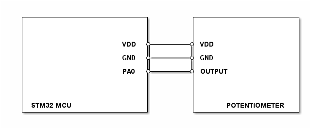

# __Example: *potentiometer_read_level*__

**Example version:** 2.0.0

[](https://dev.st.com/stm32cube-docs/examples/arch-v1/en/index.html "An offline version is also available in the Cube firmware package.")

How to use the potentiometer using the `get_level()` API.
It illustrates the process of reading the potentiometer level.


## __1. Detailed scenario__

This scenario demonstrates how to read potentiometer level with the potentiometer part driver APIs.
The following steps are executed:
__Initialization phase__: At main program start, the `mx_system_init()` function is called. It initializes the peripherals, nonvolatile memory (such as flash memory, NVM, or external memories), MPU regions (if applicable), the system clock, and the SysTick.
After that the app_init() function is called to initialize the potentiometer.

__Step 1__: Device and part initializations.

__Step 2__: The potentiometer level is read using `pot_get_level`.

__End of example__: The step 2 is repeated indefinitely if no error occurs.

If you enable `USE_TRACE`, you can follow these execution steps in the terminal logs:

```text
[INFO] Step 1: Device initialization COMPLETED.

[INFO] Step 2: Read potentiometer level COMPLETED
...
```


## __2. Example configuration__

[](https://dev.st.com/stm32cube-docs/examples/arch-v1/en/configure/config_toc.html "An offline version is also available in the Cube firmware package.")


This example demonstrates the potentiometer part driver via ADC.

The ADC must be configured for single channel conversions, from regular group, with a software trigger and started in polling mode.


## __3. Hardware environment and setup__

### __3.1. Generic Setup__

This section describes the hardware setup principles that apply to any board.

<!--
@startuml
@startditaa{doc/generic_hardware_setup.png}
  +-------------------------+        +---------------------+
  |                         +        |                     |
  |                         |        |                     |
  |                         |        |                     |
  |                    VDD  *--------* VDD                 |
  |                         |        |                     |
  |                    GND  *--------* GND                 |
  |                         |        |                     |
  |                    PA0  *--------* OUTPUT              |
  |                         |        |                     |
  |                         |        |                     |
  |                         |        |                     |
  |                         |        |                     |
  | STM32 MCU               |        |      POTENTIOMETER  |
  +-------------------------+        +---------------------+
@endditaa
@enduml
-->



### __3.2. Specific board setups__


<details>
  <summary>On STM32H7P series.</summary>
  <details>
    <summary>On board STM32H7P5I-DK.</summary>

  | MCU pin | Signal name     |
  | :---:   | :---:           |
  | PF2     | ADC_SIGNAL      |

  </details>
</details>


## __4. Troubleshooting__

[](https://dev.st.com/stm32cube-docs/examples/arch-v1/en/debug/debug_toc.html "An offline version is also available in the Cube firmware package.")


Here are points of attention for this specific example:

For STM32U575I-EV boards, jumpers 21 and 22 should be in the following configuration:

- JP21: `[1-2]`
- JP22: `[2-3]`


## __5. See Also__

[](https://dev.st.com/stm32cube-docs/examples/arch-v1/en/more/more_toc.html "An offline version is also available in the Cube firmware package.")


## __6. License__

Copyright (c) 2026 STMicroelectronics.

This software is licensed under terms that can be found in the LICENSE file in the root directory of this software component.
If no LICENSE file comes with this software, it is provided AS-IS.
