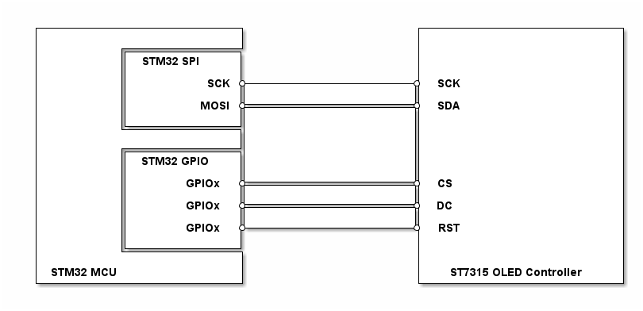

# __Example: *st7315_display_image*__

**Example version:** 2.0.0

[](https://dev.st.com/stm32cube-docs/examples/arch-v1/en/index.html "An offline version is also available in the Cube firmware package.")

This example demonstrates how to display a monochrome bitmap image using the ST7315 128x64 OLED display controller, used in OLED modules such as the GJX-2864TSWBG09.


## __1. Detailed scenario__

__Initialization phase__: At main program start, the `mx_system_init()` function is called. It initializes the peripherals, nonvolatile memory (such as flash memory, NVM, or external memories), MPU regions (if applicable), the system clock, and the SysTick.

__Step 1__: Initializes the ST7315 instance.

__Step 2__: Renders the ST logo monochrome bitmap into the frame buffer and transfers it to the display.


__End of example__: A static image is displayed on the screen. You can verify that the example runs properly via the status LED and the `ExecStatus` variable.

If you enable `USE_TRACE`, you can follow these execution steps in the terminal logs:

```text
[INFO] Step 1: Device initialization COMPLETED.

[INFO] Step 2: ST Logo Displayed.

```


## __2. Example configuration__

[](https://dev.st.com/stm32cube-docs/examples/arch-v1/en/configure/config_toc.html "An offline version is also available in the Cube firmware package.")

__GPIO__: OLED Part Driver Control Pins

The OLED part driver manages control signals through specific GPIO pins. These pins should be configured as follows:

- Chip Select (CS): Configured as an output pin with push-pull.
- Data/Command (DC): Configured as an output pin with push-pull, driven LOW for command mode and HIGH for data mode.
- Reset (RST): Configured as an output pin with push-pull.

__SPI__: OLED Part Driver Configuration

The OLED part driver is controlled through the SPI peripheral configured as follows:

- Mode: Controller
- Direction: 1-line transmit only
- Data size: 8 bits
- Clock polarity: Low (CPOL = 0)
- Clock phase: First edge (CPHA = 0)
- NSS: Software controlled
- Baud rate prescaler: /32, yielding 6.25 MHz at the 200 MHz SPI input clock used on the STM32H7P5I-DK, which stays within the 10 MHz ST7315 maximum


## __3. Hardware environment and setup__

### __3.1. Generic Setup__

This section describes the hardware setup principles that apply to any board.

<!--
@startuml
@startditaa{doc/generic_hardware_setup.png}
  +-------------------------+                     +-------------------------+
  |                         |                     |                         |
  |          +--------------+                     |                         |
  |          | STM32 SPI    |                     |                         |
  |          |              |                     |                         |
  |          |          SCK *---------------------*  SCK                    |
  |          |              |                     |                         |
  |          |         MOSI *---------------------*  SDA                    |
  |          |              |                     |                         |
  |          +--------------+                     |                         |
  |                         |                     |                         |
  |          +--------------+                     |                         |
  |          | STM32 GPIO   |                     |                         |
  |          |              |                     |                         |
  |          |       GPIOx  *---------------------*  CS                     |
  |          |              |                     |                         |
  |          |       GPIOx  *---------------------*  DC                     |
  |          |              |                     |                         |
  |          |       GPIOx  *---------------------*  RST                    |
  |          |              |                     |                         |
  |          +--------------+                     |                         |
  |                         |                     |                         |
  | STM32 MCU               |                     | ST7315 OLED Controller  |
  +-------------------------+                     +-------------------------+
@endditaa
@enduml
-->



### __3.2. Specific board setups__

This section describes the exact hardware configurations for supported boards.

<details>
  <summary>On STM32H7P series.</summary>
  <details>
    <summary>On board STM32H7P5I-DK.</summary>

  The ST7315 controller is integrated on GJX-2864TSWBG09 OLED mounted on the STM32H7P5I-DK board.

  |  MCU pin  |  Signal name    |  User Label  |
  |:---------:|:---------------:|:------------:|
  |    PG4    |  CS_DISP        |      -       |
  |    PE1    |  RST_DISP       |      -       |
  |    PG6    |  D/C_DISP       |      -       |
  |    PG9    |  SPI_SCK_DISP   |      -       |
  |    PG5    |  SPI_MOSI_DISP  |      -       |


   </details>
</details>


## __4. Troubleshooting__

[](https://dev.st.com/stm32cube-docs/examples/arch-v1/en/debug/debug_toc.html "An offline version is also available in the Cube firmware package.")

Here are the points of attention for this specific example:

__SPI clock__: If the image is displayed abnormally or corrupted, ensure that the SPI clock frequency does not exceed the maximum SPI clock frequency supported by the ST7315. The ST7315 datasheet specifies a minimum serial clock period of 100 ns, which corresponds to a maximum SPI clock frequency of 10 MHz for both 4-wire and 3-wire SPI modes. The default configuration uses a /32 prescaler (6.25 MHz at 200 MHz SPI input clock), which provides safe margin. If porting to a different board or clock tree, recompute the prescaler to keep the SPI clock at or below 10 MHz.

__Frame buffer layout__: The ST7315 uses a page-based frame buffer where each byte represents 8 vertically stacked pixels. The total frame buffer size is 128 x 8 bytes (1024 bytes) for a 128x64 monochrome display.


## __5. See Also__

[](https://dev.st.com/stm32cube-docs/examples/arch-v1/en/more/more_toc.html "An offline version is also available in the Cube firmware package.")

The documentation of the drivers of the relevant STM32 series contains more detailed information.

More information about the STM32 ecosystem can be found in the [STM32 MCU Developer Zone](https://www.st.com/content/st_com/en/stm32-mcu-developer-zone/embedded-software.html).


## __6. License__

Copyright (c) 2026 STMicroelectronics.

This software is licensed under terms that can be found in the LICENSE file in the root directory
of this software component.
If no LICENSE file comes with this software, it is provided AS-IS.
